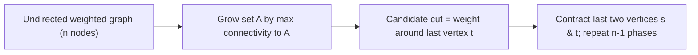

# Undirected Global Minimum Cut

## What it is
Given an undirected weighted graph $G = (V, E, w)$, the **global minimum cut** problem seeks a nonempty proper bipartition $(S, V \setminus S)$ minimizing total crossing edge weight — with **no fixed source or sink**.

## How it works
1. **$|V| - 1$ $s$-$t$ max-flow reduction (`global_min_cut_flows`)**: Fix an arbitrary vertex $v_0 = 0$. Every nonempty bipartition puts $0$ on one side and at least one vertex $t \ne 0$ on the other side, so taking $\min_{1 \le t < n} \mathrm{max\_flow}(0, t)$ using [Ford–Fulkerson / Edmonds–Karp](#/ford_fulkerson) (with symmetric undirected edge capacities) finds the global minimum cut in $|V|-1$ flow calls.
2. **Stoer–Wagner contraction (`stoer_wagner`)**: In each of $V - 1$ phases, grow a vertex set $A$ starting from an arbitrary vertex by greedily adding the remaining vertex with highest total edge weight into $A$ (maximum adjacency ordering). The **cut-of-the-phase** separating the last added vertex $t_{\text{last}}$ from the rest is guaranteed to be a minimum $s$-$t_{\text{last}}$ cut for its predecessor $s$; record it, contract $\{s, t_{\text{last}}\}$ into a single super-node summing weights, and repeat without ever running max-flow!

## Complexity
* **$|V| - 1$ flow calls**: $O(V^2 E^2)$ using Edmonds–Karp.
* **Stoer–Wagner**: $O(V^3)$ with array scan (implemented here) or $O(V E + V^2 \lg V)$ with a priority queue, much faster than $|V|-1$ general max-flow runs.

## When to use it
For network reliability (minimum bottleneck failure capacity), image segmentation, and VLSI/graph clustering when endpoints are unconstrained.

## In this implementation
Both `global_min_cut_flows` and `stoer_wagner` are verified against exhaustive enumeration of all $2^{n-1} - 1$ bipartitions on 50 random weighted undirected graphs, including disconnected graphs and parallel edge accumulations.
