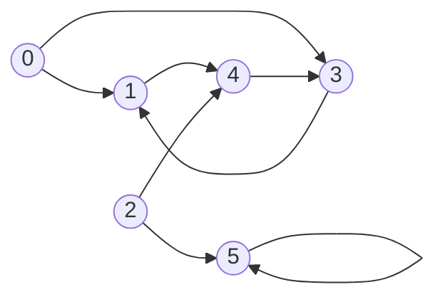

# Graph Representations

## What it is
A graph `G = (V, E)` can be stored as **adjacency lists** (an array `Adj[u]` of the neighbours of each vertex) or as an **adjacency matrix** (a `|V| × |V|` array with `A[u][v] = 1` iff `(u, v) ∈ E`).

## How it works
| | Adjacency list | Adjacency matrix |
|---|---|---|
| Space | Θ(V + E) | Θ(V²) |
| Is `(u,v)` an edge? | O(deg u) | O(1) |
| List neighbours of `u` | Θ(deg u) | Θ(V) |
| Best for | sparse graphs | dense graphs, many edge queries |

Exercises of Section 22.1 give small algorithms on the two representations:
* **Transpose** `Gᵀ` (reverse every edge) in Θ(V+E) with lists — a step in [strongly connected components](#/strongly_connected_components).
* **Square** `G²` (edge if a path of ≤ 2 edges exists).
* **Universal sink**: a vertex with in-degree `|V|−1` and out-degree 0 can be found by probing only `O(V)` matrix entries: at probe `(i, j)`, an edge `i → j` rules out `i` as a sink; no edge rules out `j` as a universal sink; one pointer advances each step.

## Complexity
See the table; building either representation from an edge list takes Θ(V + E) (lists) or Θ(V² + E) (matrix).

## When to use it
Lists for almost every traversal algorithm in this chapter ([BFS](#/breadth_first_search), [DFS](#/depth_first_search), [Dijkstra](#/dijkstra)); matrices for [Floyd–Warshall](#/floyd_warshall) and dense-graph flows.

## In this implementation
`AdjList = Vec<Vec<usize>>`, `AdjMatrix = Vec<Vec<bool>>`; conversions, `transpose`, `square`, `universal_sink`, `degrees`.
