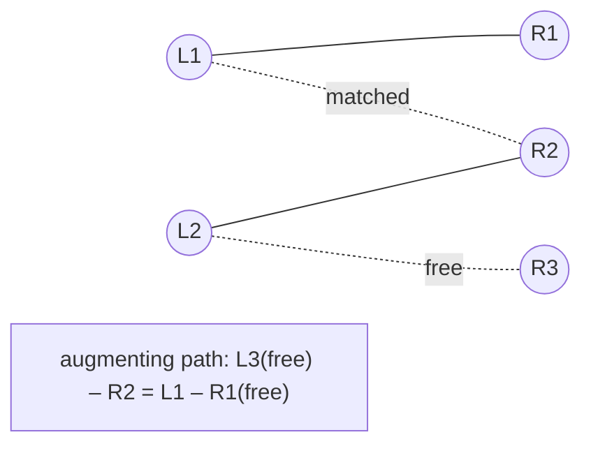

# Hopcroft-Karp Matching

## What it is
The fourth edition adds a new chapter on **matchings in bipartite graphs**. Its first algorithm is **Hopcroft–Karp** (1973), which finds a maximum matching in `O(E √V)` time — faster than the `O(VE)` bound of the [flow-based reduction](#/maximum_bipartite_matching).

## How it works
Given a matching `M`, an **augmenting path** alternates between unmatched and matched edges and joins two unmatched vertices; flipping it enlarges `M` by one (Berge's theorem: `M` is maximum iff no augmenting path exists). Instead of one path per search, Hopcroft–Karp works in **phases**:

1. A **BFS** from all free left vertices assigns layers and finds the *length of the shortest augmenting paths*.
2. A **DFS** along the layered graph finds a *maximal set of vertex-disjoint shortest augmenting paths* and augments all of them.

After `√V` phases the shortest augmenting path has length > `2√V`, so at most `√V` more paths remain (they are vertex-disjoint) — hence `O(√V)` phases of `O(E)` work.

## Complexity
`O(E √V)`.

## When to use it
Large assignment problems with unit capacities: job/worker allocation, scheduling, image feature matching; a building block for [assignment](#/hungarian) in dense settings and for min vertex cover in bipartite graphs (König).

## In this implementation
Arrays `ml`/`mr` hold the two sides' partners; dead-end vertices get `dist = ∞` so the DFS never revisits them within a phase. Results are compared with the flow-based matcher on random graphs.
