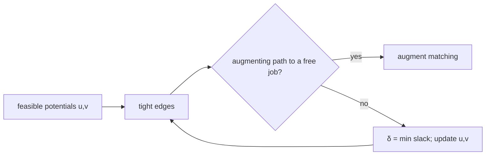

# Hungarian Algorithm (Assignment Problem)

## What it is
Given `n` workers, `n` jobs and a cost `c_ij` for giving job `j` to worker `i`, the **assignment problem** asks for the one-to-one assignment of minimum total cost — a minimum-cost perfect matching in a complete bipartite graph. Kuhn's **Hungarian algorithm** (1955, after König and Egerváry) solves it in `O(n³)`; the 4th edition gives it as Section 25.2 (in max-weight form).

## How it works
Maintain **vertex potentials** `u_i` (workers) and `v_j` (jobs) satisfying `u_i + v_j ≤ c_ij` for all pairs (a feasible dual solution of the LP). An edge is *tight* when equality holds. If the tight edges contain a perfect matching it is optimal (complementary slackness).

For each worker in turn, search for an **augmenting path** in the tight-edge graph by Dijkstra-like exploration; if the search gets stuck, adjust potentials by the smallest slack `δ` (`u += δ` on reached workers, `v −= δ` on reached jobs) to create a new tight edge, and continue. Each worker needs at most `n` adjustments of `O(n)` each.

## Complexity
`O(n³)`; the potentials also prove optimality (LP duality; compare [simplex](#/simplex)).

## When to use it
Task assignment, multi-object tracking in vision (matching detections to tracks), optimal transport on small problems, pairing in logistics. With sparse or unit weights [Hopcroft–Karp](#/hopcroft_karp) is faster.

## In this implementation
The compact potentials-based formulation with a `way` array to flip the alternating path. Tests compare it with permutation enumeration for random matrices (including negative costs), and a wrapper gives maximum-weight assignment.
