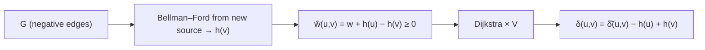

# Johnson's Algorithm

## What it is
For **sparse** graphs, running Dijkstra from every vertex beats [Floyd–Warshall](#/floyd_warshall) — but Dijkstra needs non-negative weights. Johnson's algorithm removes negative weights by **reweighting** the graph so shortest paths are preserved, then runs Dijkstra `|V|` times.

## How it works
1. Add a new vertex `s` with 0-weight edges to every vertex and run [Bellman–Ford](#/bellman_ford) from `s`, giving potentials `h(v) = δ(s, v)`. A negative cycle makes the algorithm report failure.
2. Reweight each edge: `ŵ(u, v) = w(u, v) + h(u) − h(v)`. The triangle inequality guarantees `ŵ ≥ 0`.
3. Run [Dijkstra](#/dijkstra) from every `u` on `ŵ`.
4. Undo the reweighting: `δ(u, v) = δ̂(u, v) − h(u) + h(v)`.

**Why shortest paths are preserved** (Lemma 25.1): along any path the potentials telescope: `ŵ(p) = w(p) + h(v₀) − h(v_k)`, so the ordering of paths between fixed endpoints is unchanged; and cycles keep their weight.

## Complexity
O(V² lg V + V E) with a binary heap, O(V² lg V + VE) → `O(V² lg V + VE)`; with Fibonacci heaps `O(V² lg V + VE)`. Compare with Θ(V³) for Floyd–Warshall: better when `E = o(V²)`.

## When to use it
Large sparse networks with a few negative edges (e.g. cost-adjusted road/transport networks, arbitrage-free currency graphs).

## In this implementation
Potentials come from this repository's Bellman–Ford; random graphs with negative edges are compared with Floyd–Warshall, including negative-cycle detection.
