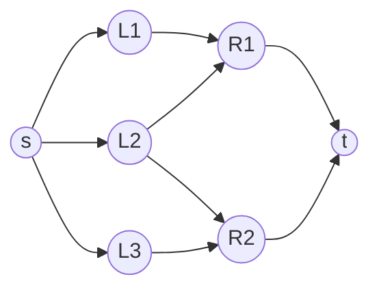

# Maximum Bipartite Matching via Flow

## What it is
A **matching** in an undirected graph is a set of edges no two of which share a vertex. In a **bipartite** graph `G = (L ∪ R, E)` (think workers and jobs) a *maximum matching* contains as many edges as possible. Section 26.3 shows it is a special case of maximum flow.

## How it works
Build a flow network `G'`: add a source `s` with an edge `s → l` of capacity 1 for every `l ∈ L`, a sink `t` with `r → t` of capacity 1 for every `r ∈ R`, and direct each original edge `l → r` with capacity 1. Then:
* every matching `M` yields a flow of value `|M|`;
* the **Integrality theorem** (Theorem 26.10) says that when all capacities are integers, [Ford–Fulkerson](#/ford_fulkerson) finds an *integral* maximum flow, so each edge carries 0 or 1 unit and the saturated middle edges form a matching of size `|f|`.

## Complexity
`O(V·E)`: the flow value is at most `min(|L|, |R|) = O(V)` and each augmentation costs `O(E)`. [Hopcroft–Karp](#/hopcroft_karp) improves it to `O(E √V)`.

## When to use it
Assigning workers to jobs, students to projects, organ donors to recipients, scheduling. By König's theorem the size of a maximum matching equals the size of a minimum vertex cover in a bipartite graph (and Hall's theorem tells exactly when a left-perfect matching exists).

## In this implementation
Reuses the paired-edge `FlowNetwork` of the [Edmonds–Karp module](#/ford_fulkerson); results are validated as matchings and compared with exhaustive search.
