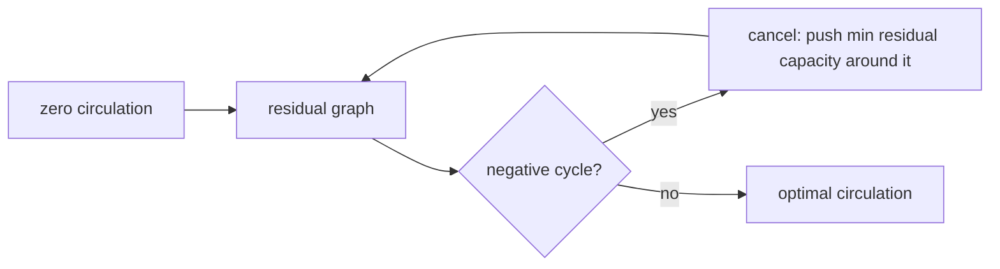

# Minimum-Cost Circulation by Cycle Canceling

## What it is
A **circulation** is a flow with no source and sink: flow conservation holds at *every* vertex. Given edge capacities and (possibly negative) per-unit costs, a **minimum-cost circulation** is a circulation of least total cost. Problem 29-5 shows it is a linear program — and that [minimum-cost flow](#/min_cost_flow) (send `d` units from `s` to `t`), [maximum flow](#/ford_fulkerson) and [shortest paths](#/lp_formulations) all reduce to it (add a return edge `t → s`).

## How it works
**Optimality criterion.** A circulation is minimum-cost iff its **residual graph has no negative-cost cycle**: a negative cycle could be saturated to lower the cost, and conversely if none exists one can show no feasible circulation is cheaper (the difference of two circulations decomposes into residual cycles).

**Cycle canceling.** Start from the zero circulation (feasible when all lower bounds are 0). Repeat: find a negative cycle in the residual graph with [Bellman–Ford](#/bellman_ford) (a relaxation in the `n`-th round exposes one; step back `n` predecessors to land on it), then push the bottleneck residual capacity around it. With integer capacities and costs each cancelling lowers the cost by at least 1, so the process terminates; choosing the *minimum mean-weight* cycle ([Karp](#/minimum_mean_cycle)) makes it strongly polynomial.

## Complexity
Pseudo-polynomial `O(V E · E·C·U)`-style bound for arbitrary cycles (`C` max cost, `U` max capacity); polynomial with minimum-mean cycles or capacity scaling.

## When to use it
Transportation, scheduling with profits, tax/currency conversion cycles, and as a teaching tool for the residual-graph optimality condition behind all flow algorithms.

## In this implementation
Edges are `(u, v, capacity, cost)` and may have negative costs. Tests compare the final cost with the optimum of the equivalent linear program (solved by this repository's simplex) on 150 random networks, verify conservation and capacity feasibility, and check a profitable triangle is filled to capacity (cost `−9`).
