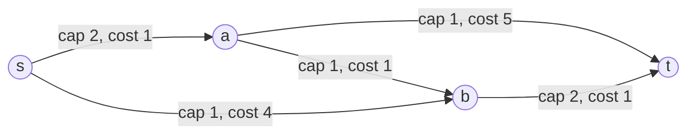

# Minimum-Cost Flow

## What it is
In the **minimum-cost flow** problem every edge has a capacity *and* a cost per unit of flow; we must send a prescribed amount `d` of flow from source to sink at the least total cost. It generalises [maximum flow](#/ford_fulkerson), [shortest paths](#/dijkstra) (send one unit) and the [assignment problem](#/hungarian), and it is one of the standard LP formulations of Section 29.2 (solved there with the [simplex method](#/simplex), see [LP formulations](#/lp_formulations)).

## How it works
**Successive shortest paths.** Maintain a flow and its *residual graph*: a forward edge keeps residual capacity `c − f` with cost `+a`, and each unit of flow creates a reverse residual edge of cost `−a` (cancelling flow *saves* its cost). Repeat until `d` units are sent: find a **cheapest path** from `s` to `t` in the residual graph ([Bellman–Ford](#/bellman_ford) because of the negative reverse costs, or Dijkstra with potentials after reweighting as in [Johnson](#/johnson)) and push as much flow as its bottleneck allows.

**Correctness.** A flow of value `k` is minimum-cost iff the residual graph has **no negative-cost cycle** (optimality criterion). Augmenting along a shortest path preserves this invariant, so after `d` augmentation units the flow is optimal; path costs are non-decreasing.

## Complexity
`O(d · V·E)` with Bellman–Ford per augmentation (`O(d·E lg V)` with potentials and Dijkstra); polynomial algorithms (capacity scaling, cycle-cancelling variants, network simplex) are independent of `d`.

## When to use it
Transportation and assignment problems, supply-chain routing, project crashing, matching with weights, and "min-cost circulation" in scheduling. It is the workhorse behind many optimisation libraries.

## In this implementation
`CostNetwork` stores paired residual edges (cost `−c` on the reverse). Tests verify that random **assignment problems** modelled as flows have exactly the cost computed by the [Hungarian algorithm](#/hungarian), and check a hand-computed network.
