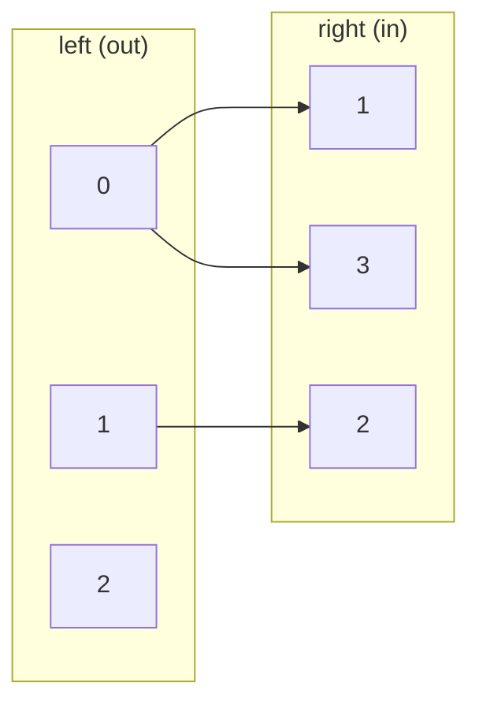

# Minimum Path Cover of a DAG

## What it is
A **path cover** of a directed acyclic graph `G` is a set of paths such that every vertex lies on at least one path. Problem 26-2 asks for the *minimum* number of paths. Variants: the paths must be **vertex-disjoint**, or may **share** vertices. It is solved by reduction to [bipartite matching](#/maximum_bipartite_matching) — a typical use of flows beyond routing.

## How it works
**Vertex-disjoint paths.** Build a bipartite graph with a left copy `v_out` and a right copy `v_in` of every vertex, and an edge `u_out — v_in` for every edge `(u, v)` of `G`. A matching `M` chooses a set of edges in which each vertex has at most one successor and one predecessor, i.e. a set of disjoint paths; the number of paths is `|V| − |M|` (every matched edge merges two paths). Maximising `|M|` ([Hopcroft–Karp](#/hopcroft_karp) or max-flow) minimises the cover: **`|V| − |M*|`**.

**Overlapping paths.** First add an edge `(u, v)` whenever `v` is reachable from `u` (the transitive closure, via [Warshall](#/floyd_warshall)); skipping over vertices is then free. By **Dilworth's theorem** the minimum number of paths in this setting equals the size of a **maximum antichain** (a largest set of pairwise unreachable vertices).

## Complexity
`O(E√V)` with Hopcroft–Karp (plus `O(V³)` for the closure in the overlapping variant).

## When to use it
Scheduling tasks on the fewest machines/workers, covering a test suite's code paths with the fewest runs, minimising the number of buses or trains for fixed timetabled trips, and as the standard illustration of Dilworth's theorem.

## In this implementation
The vertex-disjoint cover is validated (partition of the vertices into real paths) and compared with an exhaustive search; the overlapping version is compared with a brute-force maximum antichain for DAGs of up to 8 vertices.
