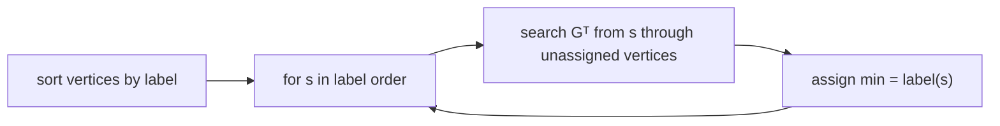

# Minimum Reachable Label

## What it is
Each vertex of a directed graph has a distinct label. For every vertex `v`, find `min(v)`, the **smallest label among all vertices reachable from `v`** (including `v`). Problem 22-4 asks for an `O(V + E)` algorithm — faster than running a search from every vertex (`Θ(V(V+E))`).

## How it works
Reverse the question: instead of asking what each vertex can reach, ask *who can reach the smallest-labelled vertex?*
1. Compute the **transpose** graph `Gᵀ`.
2. Process vertices in **increasing label order**. For vertex `s`, search `Gᵀ` from `s` (a [DFS/BFS](#/depth_first_search)), visiting only vertices not yet assigned; every vertex found can reach `s`, and since all smaller labels were processed earlier without reaching it, `s`'s label is its minimum: assign `min(v) = label(s)`.
3. Each vertex and each transpose edge is examined at most once overall: `Θ(V + E)` (after sorting the labels; for labels `1…V` use counting sort).

## Complexity
`Θ(V + E)` plus label sorting.

## When to use it
Computing reachability summaries (e.g. earliest ancestor, minimum timestamp reachable) over large graphs; the trick of processing in label order and sweeping the **reverse** graph also drives [Kosaraju's SCC algorithm](#/strongly_connected_components).

## In this implementation
Tests compare against a search from every vertex on 200 random digraphs with shuffled labels.
