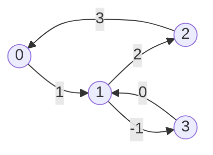

# Minimum Mean-Weight Cycle (Karp)

## What it is
Given a directed weighted graph, the **mean weight** of a cycle is its total weight divided by its number of edges. Problem 24-5 develops **Karp's algorithm** (1978) for the minimum mean-weight cycle `μ*` in `O(VE)` time. The value `μ*` is the largest `λ` for which re-weighting every edge by `−λ` leaves no negative cycle, so it quantifies "how close" the graph is to having one.

## How it works
Let `δ_k(v)` be the minimum weight of a walk with **exactly `k` edges** ending at `v`, starting anywhere (a virtual source with free edges to all vertices). Karp's theorem:

`μ* = min_{v} max_{0≤k≤n−1} ( δ_n(v) − δ_k(v) ) / (n − k)`,

over vertices with `δ_n(v) < ∞`. The proof shifts all weights by `μ*` so the minimum mean is 0, then shows that for some vertex `v` on a zero-weight cycle `δ_n(v) = δ_k(v)` for all `k` in a certain range.

(The cycle `1 → 3 → 1` has mean −½, beating the triangle's mean 2.)

## Complexity
`O(V E)` time and `O(V²)` space for the `δ` table.

## When to use it
Performance analysis of discrete-event systems (the iteration bound of a data-flow graph — the lower bound on clock period for a *synchronous circuit* with registers on edges), minimum cost-to-time ratio cycles, parametric shortest paths.

## In this implementation
`min_mean_cycle` returns `None` for acyclic graphs. Random small graphs are checked against explicit enumeration of simple cycles.
