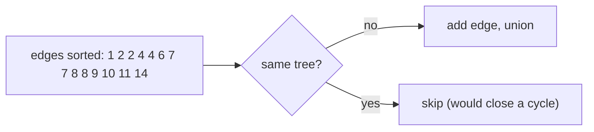

# Kruskal's Minimum Spanning Tree

## What it is
Given a connected, undirected, weighted graph, a **minimum spanning tree (MST)** is a subset of edges that connects all vertices with minimum total weight (and so has no cycles). Chapter 23 builds MST theory with the **generic algorithm**: grow a set `A` of edges, always adding a *safe edge* — one that keeps `A` a subset of some MST. The **cut property** (Theorem 23.1) identifies safe edges: the lightest edge crossing any cut that respects `A`.

## How it works
Kruskal's algorithm treats `A` as a forest and repeatedly adds the lightest edge that connects two different trees:
1. Sort the edges by weight.
2. For each edge `(u, v)`: if `FIND-SET(u) ≠ FIND-SET(v)` (no cycle), add it and `UNION(u, v)` using a [disjoint-set forest](#/disjoint_set).

**Problem 23-1 — second-best MST.** A second-best tree differs from the MST `T` by swapping a single edge: add a non-tree edge `(u,v)` and delete the heaviest edge on the tree path `u…v`. Precompute `max[u][v]` for all pairs in `O(V²)` and take the best swap.

## Complexity
`O(E lg E) = O(E lg V)` dominated by sorting; the union-find phase is `O(E α(V))`.

## When to use it
Network design (cable, pipeline, road layout), clustering (single-linkage = stop Kruskal early at `k` components), approximation algorithms ([metric TSP](#/approx_tsp)), image segmentation. Prefer [Prim's algorithm](#/mst_prim) for dense graphs.

## In this implementation
Returns the total weight and the chosen edge indices (a minimum spanning *forest* if the graph is disconnected). Randomised tests enumerate all spanning trees to check both the MST and the second-best weight.
