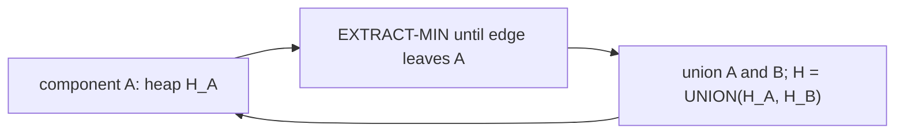

# MST with Mergeable Heaps

## What it is
Problem 19-2 shows that [mergeable heaps](#/binomial_heap) — heaps supporting `UNION` in `O(lg n)` — yield a neat minimum spanning tree algorithm. Each connected component of the growing forest keeps a heap of the edges that touch it; combining two components combines their heaps. It sits between [Kruskal](#/mst_kruskal) (global sorted list, [union-find](#/disjoint_set)) and [Borůvka](#/boruvka) (all components pick in rounds).

## How it works
1. Make a heap for each vertex containing its incident edges.
2. Take any component `C`. Repeatedly **EXTRACT-MIN** from its heap until the edge's two endpoints lie in *different* components (edges that became internal after earlier unions are simply discarded — lazy deletion).
3. That edge is the lightest edge leaving `C`, hence **safe** by the cut property ([generic MST](#/generic_mst)). Add it to the tree, union the two components and **UNION their heaps**.
4. Re-queue the merged component; stop when no component has an outgoing edge.

Every edge is inserted twice and extracted at most twice; each heap operation is `O(lg E)` (the UNION of leftist, binomial or Fibonacci heaps costs `O(lg n)`, `O(lg n)` or `O(1)`), so the total is **`O(E lg V)`**.

## Complexity
`O(E lg V)` with leftist or binomial heaps; `O(E + V lg V)` with Fibonacci heaps (as for Prim).

## When to use it
Whenever heaps merge naturally, e.g. in contraction-based MST algorithms and in the "small to large"-free implementation of Kruskal-like procedures; a good demonstration of why mergeable heaps are worth having.

## In this implementation
The mergeable heap is a **leftist heap** (right-spine merge, `O(lg n)`). The tests compare weight and tree size with Kruskal on 200 random graphs that include self-loops, parallel edges and disconnected pieces, and check the leftist heap sorts 500 random keys.
