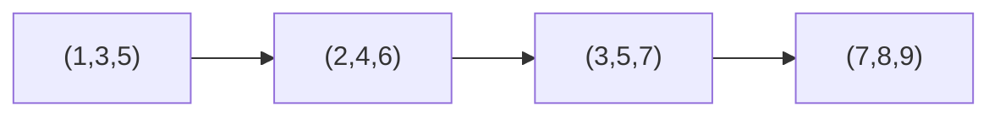

# Nesting Boxes

## What it is
A `d`-dimensional box with dimensions `(x₁, …, x_d)` **nests** inside a box `(y₁, …, y_d)` if some permutation `π` of the dimensions satisfies `x_{π(1)} < y₁, …, x_{π(d)} < y_d`. Problem 24-2 (a graph-algorithms problem) asks you to (a) show the nesting relation is transitive, (b) give an efficient test, and (c) find the longest sequence of boxes `B₁ ⊂ B₂ ⊂ … ⊂ B_k`.

## How it works
* **Test in `O(d lg d)`:** sort both boxes' dimensions; `A` nests in `B` iff `aᵢ < bᵢ` for all `i` in sorted order (matching smallest to smallest is optimal by an exchange argument — exactly the reasoning behind greedy matching).
* **Transitivity** follows from the sorted-order test (strict inequality chains).
* **Longest chain:** build the **nesting DAG** (edge `A → B` if `A` nests in `B`; acyclic because dimension sums strictly increase) and find the longest path with the [DAG longest-path DP](#/longest_simple_path_dag): `O(n² d + n d lg d)`. The chain is a longest increasing subsequence in the partial order — compare [LIS](#/longest_increasing_subsequence).

## Complexity
`O(n²·d + n·d lg d)` time for the chain, `O(n·d)` space.

## When to use it
Stacking/packing problems (Russian-doll envelopes in 2-D), pairwise-dominance orders (Pareto dominance chains), and as a standard example of reducing a combinatorial question to a longest path in a DAG.

## In this implementation
`nests` is validated against trying **all** dimension permutations on 500 random pairs; the chain length is compared with exhaustive search over all subsets of up to 8 boxes.
