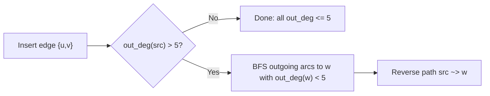

# Dynamic Planar Graph Low-Outdegree Orientation

## What it is
CLRS Problem 20-5 asks how to maintain a **planar graph** dynamically under vertex and edge insertions while answering adjacency queries `has_edge(u, v)` in **$O(1)$ worst-case time**. Any planar graph (and every subgraph of it) satisfies $|E| \le 3|V| - 6$, so average degree is strictly less than $6$ and an orientation with **$\text{out-degree}(v) \le 5$ everywhere** always exists.

## How it works
* **Bounded-outdegree storage (`DynamicPlanarGraph`)**: Store each undirected edge `{u, v}` in exactly one endpoint's outgoing list (`out_adj[src]`). Querying `has_edge(u, v)` scans `out_adj[u]` and `out_adj[v]` — at most $5 + 5 = 10$ checks in $O(1)$ worst-case time.
* **Incremental path-reversal rebalancing (`add_edge` / `add_vertex_with_edges`)**: When an insertion raises `out_degree(u)` to `6`, run BFS along outgoing arcs from `u` to locate a vertex `w` with `out_degree(w) < 5`. Because every induced subgraph $H$ has $|E(H)| < 3|V(H)|$, the reachable subgraph $R$ from $u$ cannot have out-degree $\ge 5$ at every node, guaranteeing such a sink `w` exists! Reversing all arcs along the directed path $u \rightsquigarrow w$ drops `u`'s out-degree by $1$, preserves intermediate vertices, and raises `w`'s out-degree to $\le 5$.
* **Static 5-degeneracy peeling (`orient_planar_static`)**: For a static [graph representation](#/graph_representations), repeatedly peel any vertex of degree $\le 5$ and orient its incident edges outward in $O(V + E)$ time.

## Complexity
* **Adjacency query (`has_edge`)**: $O(1)$ worst-case ($\le 10$ comparisons).
* **Static orientation**: $O(V + E) = O(V)$ time.
* **Dynamic insertion**: $O(V)$ worst-case per rebalance (or $O(\lg V)$ amortized in Chrobak–Eppstein / Brodal–Fagerberg bounded-outdegree schemes).

## When to use it
Whenever sparse planar networks (road maps, meshes, circuit layouts) need compact memory and constant-time edge lookups without $O(V^2)$ adjacency matrices or hash collisions.

## In this implementation
`DynamicPlanarGraph` and `orient_planar_static` verify strict `max_out_degree() <= 5` and exact `has_edge` symmetry across incrementally built maximal planar triangulations and high-degree planar wheel hubs.
