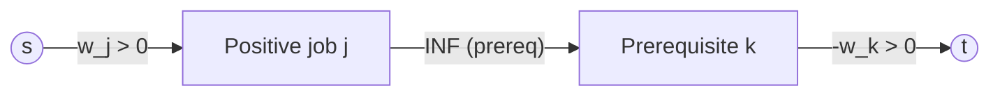

# Project Selection & Maximum-Weight Closure

## What it is
In the **project selection / maximum-weight closure** problem (CLRS "Algorithmic Consulting" in 3e/4e, "Space Shuttle payloads" in 2e), a directed graph assigns positive rewards $w_v > 0$ to projects and negative costs $w_v < 0$ to prerequisites/instruments, with directed edges $(u, v)$ meaning selecting $u$ forces selecting $v$. We seek a **closed subset** $S \subseteq V$ maximizing $\sum_{v \in S} w_v$.

## How it works
Reduce maximum-weight closure directly to minimum $s$-$t$ cut (solved via [Ford–Fulkerson / Edmonds–Karp](#/ford_fulkerson)):
1. Add source $s$ and sink $t$.
2. For each vertex $v$ with $w_v > 0$, add arc $s \to v$ with capacity $w_v$.
3. For each vertex $v$ with $w_v < 0$, add arc $v \to t$ with capacity $-w_v$.
4. For each prerequisite edge $(u, v)$, add arc $u \to v$ with capacity $\infty$.

Any finite-capacity $s$-$t$ cut $(S', T')$ must avoid infinite prerequisite edges, so $S = S' \setminus \{s\}$ is automatically closed. Its cut capacity equals missed rewards outside $S$ plus incurred costs inside $S$, meaning $\mathrm{profit}(S) = \sum_{w_v > 0} w_v - \mathrm{cap}(S', T')$.

## Complexity
* **Flow network construction**: $O(V + E)$ vertices and edges.
* **Solve time**: $O(VE^2)$ with Edmonds–Karp (or $O(V^2\sqrt{E}) / O(V^3)$ with [push-relabel](#/push_relabel)).

## When to use it
For portfolio / capital budgeting with shared dependencies, Space Shuttle payload planning, open-pit mining precedence optimization, and image segmentation MRF cuts.

## In this implementation
`max_weight_closure` and `project_selection` build the residual network with `FlowNetwork`, extract the residual source-side closure `min_cut_source_side`, and verify both prerequisite closure and exact agreement against exhaustive $2^n$ closure enumeration.
