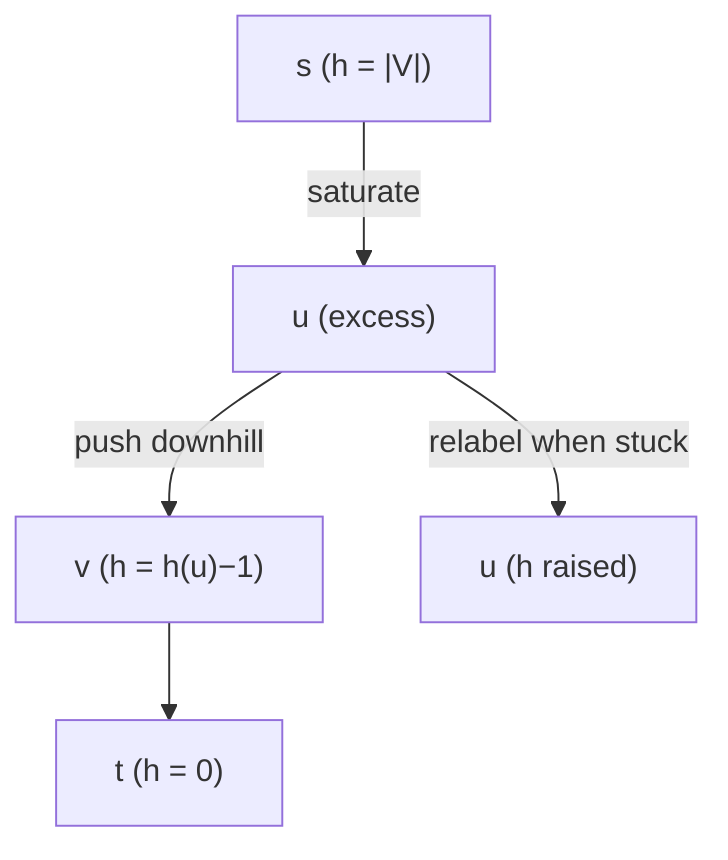

# Push-Relabel & Relabel-to-Front

## What it is
Augmenting-path algorithms ([Ford–Fulkerson](#/ford_fulkerson)) look at the network globally. **Push–relabel** algorithms work **locally**: they maintain a *preflow* — flow that may let a vertex receive more than it sends (**excess** `e(v) > 0`) — and move excess toward the sink using only information about a vertex and its neighbours. The method (Goldberg–Tarjan, 1988) appears in the 1st–3rd editions (Sections 26.4–26.5) and was dropped from the 4th.

## How it works
Every vertex has a **height** `h(v)`; initially `h(s) = |V|`, all others 0, and all edges out of `s` are saturated. Two operations:
* **PUSH(u, v)** — applicable if `u` has excess, `c_f(u,v) > 0` and `h(u) = h(v) + 1` (water flows downhill): send `min(e(u), c_f(u,v))`.
* **RELABEL(u)** — if `u` has excess but all residual neighbours are at least as high, raise `h(u)` to one more than the lowest of them.

Apply them in any order until no vertex other than `s, t` overflows. Then the preflow is a maximum flow. Heights never decrease, a height never exceeds `2|V|−1`, giving `O(V²)` relabels, `O(VE)` saturating pushes and `O(V²E)` non-saturating pushes.

**RELABEL-TO-FRONT** fixes an order: keep the vertices in a list and **discharge** each (push until its excess is 0, relabelling when stuck); if a vertex was relabelled, move it to the front and restart the scan. This gives **O(V³)**.

## Complexity
Generic `O(V²E)`; relabel-to-front `O(V³)`; with dynamic trees `O(VE lg(V²/E))`.

## When to use it
Fastest practical max-flow solvers use push-relabel with heuristics (global relabelling, gap heuristic); also parallelises well because operations are local.

## In this implementation
Dense capacity/flow matrices (skew-symmetric flow, as in the book). Both variants are checked against Edmonds–Karp on random networks.
