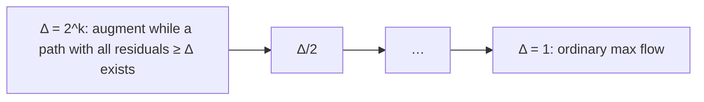

# Maximum Flow by Capacity Scaling

## What it is
Plain [Ford–Fulkerson](#/ford_fulkerson) takes time proportional to the flow value when augmenting paths are chosen badly: a network with capacities `10⁹` and one tiny cross edge can force `2·10⁹` augmentations. Problem 26-5 develops the **capacity-scaling** variant, whose running time depends only on the *number of bits* of the capacities.

## How it works
Let `C` be the largest capacity and `Δ` the largest power of 2 not exceeding `C`.
1. Find augmenting paths only in the **Δ-residual graph** `G_f(Δ)` — the residual edges whose residual capacity is **at least Δ** — and augment along them.
2. When no such path exists, halve `Δ`; stop after the phase `Δ = 1`.

**Analysis.** At the end of the phase for `Δ` there is no augmenting path with bottleneck ≥ Δ, so the minimum cut of the Δ-residual graph has capacity `< Δ·|E|` — the remaining flow to be pushed is **less than `2Δ·|E|`** (at the start of the next phase with `Δ/2`). Each augmentation in a phase pushes ≥ `Δ/2`... hence **`O(E)` augmentations per phase**, each `O(E)` with BFS/DFS, and `⌊lg C⌋ + 1` phases: **`O(E² lg C)`**.

## Complexity
`O(E² lg C)`, independent of the flow value; with Dinic-style blocking flows, `O(VE lg C)`.

## When to use it
Networks with large integer capacities where unlucky augmenting paths would otherwise cost `Θ(|f*|)`; the idea of **scaling** is also used for [shortest paths](#/gabow_scaling), minimum-cost flows and bipartite matching.

## In this implementation
The method is added to `FlowNetwork` and returns the flow plus the number of augmentations. Tests compare with [Edmonds–Karp](#/ford_fulkerson) on 100 random networks (conservation also checked) and show a `2^41`-flow network solved with fewer than 10 augmentations.
