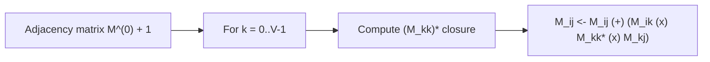

# Closed-Semiring All-Pairs Path Problems

## What it is
A single algebraic generalization from Section 26.4 of the 1st edition that unifies all-pairs shortest paths, transitive closure, widest bottleneck paths, and highest-reliability paths over a **closed semiring** $(S, \oplus, \odot, \bar{0}, \bar{1}, *)$.

## How it works
Replacing matrix addition and multiplication with semiring summary $\oplus$ and path extension $\odot$ (with Kleene closure $a^* = \bar{1} \oplus a \oplus a^2 \oplus \dots$ for cycles) yields the identical $O(V^3)$ recurrence as [Floyd-Warshall](#/floyd_warshall):
$$m_{ij}^{(k)} = m_{ij}^{(k-1)} \oplus \bigl(m_{ik}^{(k-1)} \odot (m_{kk}^{(k-1)})^* \odot m_{kj}^{(k-1)}\bigr)$$

| Problem | Carrier & Identity | $\oplus$ | $\odot$ |
| --- | --- | --- | --- |
| Reachability | `bool`, `false` / `true` | `\|\|` | `&&` |
| Shortest paths | `i64 ∪ {∞}`, `∞` / `0` | `min` | `+` |
| Widest capacity | `i64`, `0` / `∞` | `max` | `min` |
| Most reliable | `[0, 1]`, `0.0` / `1.0` | `max` | `*` |

## Complexity
$O(V^3)$ semiring operations and $O(V^2)$ space.

## When to use it
Whenever an all-pairs graph query aggregates weights associatively along paths (`min/+`, `max/min`, `max/*`, `||/&&`) without wanting to re-implement path enumeration separately.

## In this implementation
`ClosedSemiring` defines the trait and `semiring_apsp` implements the generic $O(V^3)$ recurrence, verified against `floyd_warshall` and `transitive_closure` on the textbook's directed graphs.
