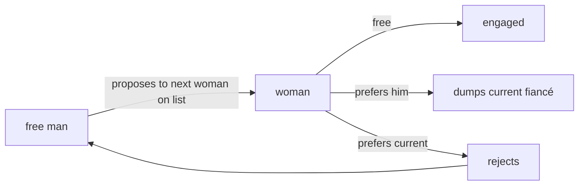

# Stable Matching (Gale-Shapley)

## What it is
In the **stable-marriage problem** there are `n` men and `n` women, each with a strict ranking of the other side. A matching is **stable** if there is no *blocking pair* — a man and a woman who each prefer the other to their assigned partners. The 4th edition's new Chapter 25 introduces the problem (Gale & Shapley, 1962; Nobel prize 2012 for the follow-up market-design work) and its famous solution.

## How it works
**Deferred acceptance** (men propose):
1. While some man `m` is free, he proposes to the highest-ranked woman on his list he has not yet proposed to.
2. If she is free she becomes engaged to him. If she is engaged to `m'` she **trades up** only if she prefers `m`; the loser becomes free again.

Properties (Theorems 25.1–25.3):
* it terminates after at most `n²` proposals;
* the result is a **stable perfect matching** (a blocking pair would mean the man proposed to the woman earlier, and she then rejected him for someone better);
* it is **man-optimal** — every man gets the best partner he has in *any* stable matching — and **woman-pessimal**.

## Complexity
Θ(n²) time and space (with precomputed ranks).

## When to use it
The National Resident Matching Program (doctors ↔ hospitals), school-choice mechanisms, kidney exchange, dating and roommate assignment. The proposing side is always at an advantage, a fact with design consequences.

## In this implementation
Tests enumerate *all* stable matchings of random instances (n ≤ 5) and verify that Gale–Shapley gives each man his best stable partner, plus a blocking-pair checker.
