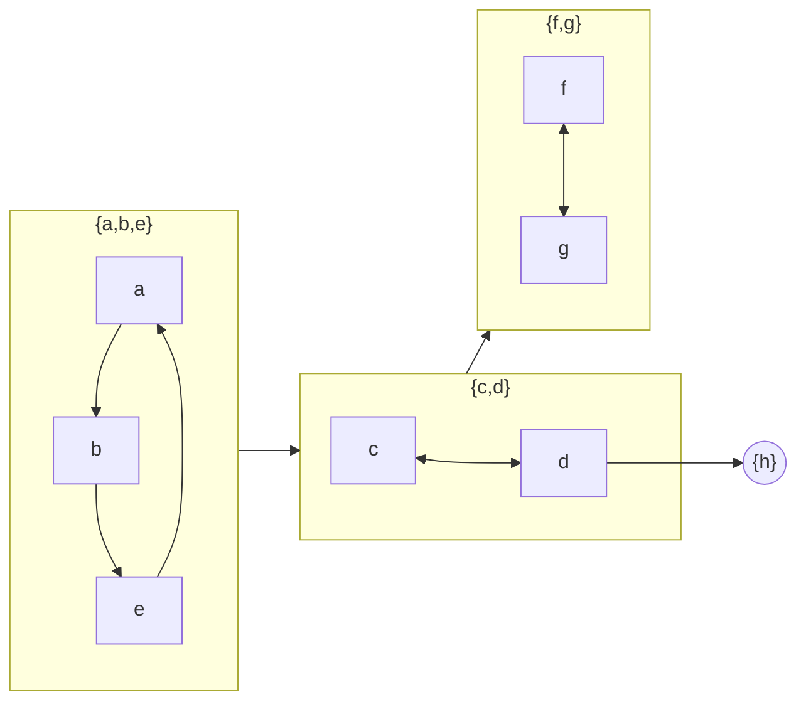

# Strongly Connected Components

## What it is
A **strongly connected component (SCC)** of a directed graph is a maximal set of vertices in which every vertex is reachable from every other. Collapsing each SCC to one vertex gives the **component graph**, which is always a DAG.

## How it works
**Kosaraju–Sharir (the book's algorithm):**
1. Run [DFS](#/depth_first_search) on `G`, recording finish times.
2. Compute the transpose `Gᵀ` (same SCCs, edges reversed).
3. Run DFS on `Gᵀ`, taking start vertices in **decreasing** finish time from step 1. Each tree of this second forest is exactly one SCC.

Why it works (Lemma 22.14): for adjacent components `C → C'`, `f(C) > f(C')`, where `f` is the latest finish time in the component. So the vertex with the largest finish time lies in a source component of the condensation; in `Gᵀ` that component has no edges leaving it, so its DFS tree cannot escape.

**Tarjan's algorithm** finds the SCCs in one pass using low-link values and a stack.

## Complexity
Θ(V + E) for either algorithm.

## When to use it
Dependency analysis (module cycles), 2-SAT, compiler data-flow analysis, web-graph structure (the "bow-tie"), model checking, and simplifying a graph before computing reachability.

## In this implementation
`strongly_connected_components` (Kosaraju using the DFS and transpose modules), `tarjan`, and `component_graph`; random digraphs are checked against the mutual-reachability definition and the condensation is verified to be acyclic.
