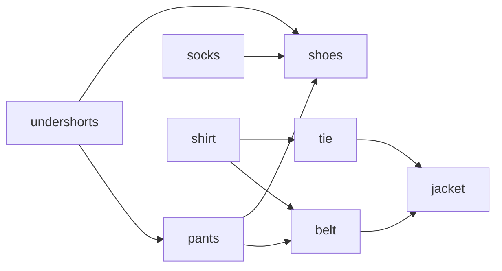

# Topological Sort

## What it is
A **topological sort** of a directed acyclic graph (DAG) is a linear ordering of its vertices such that for every edge `(u, v)`, `u` comes before `v`. It turns dependency graphs into schedules — CLRS illustrates it with Professor Bumstead getting dressed (underpants before trousers before belt…).

## How it works
**DFS method.** Run [DFS](#/depth_first_search); list vertices in **decreasing finish time**. Correctness (Theorem 22.12): for any edge `(u, v)` in a DAG, `f[v] < f[u]`, because the edge cannot be a back edge.

**Kahn's method.** Repeatedly remove a vertex of in-degree 0 and decrement its out-neighbours' in-degrees; if the process stalls with vertices left, the graph has a cycle.

Counting paths (Exercise 22.4-2): process vertices in topological order and add each vertex's path count to its successors — the same idea underlies [shortest paths in DAGs](#/dag_shortest_paths).

## Complexity
Θ(V + E) for both methods.

## When to use it
Build systems (`make`), task scheduling, course prerequisites, spreadsheet recalculation order, instruction scheduling in compilers and hardware synthesis.

## In this implementation
`topological_sort` (DFS), `kahn`, `count_paths` and `is_valid_order`; random DAGs with shuffled labels test both algorithms and cycle rejection.
