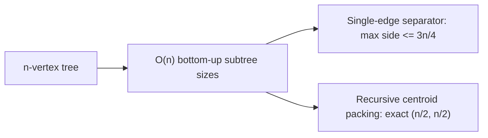

# Tree Bisection (Balanced Separator)

## What it is
Given an $n$-vertex binary or bounded-degree tree $T = (V, E)$, **Tree Bisection** (CLRS Appendix Problem B-3) partitions $V$ into two disjoint sets $(A, B)$ with **$\max(|A|, |B|) \le \frac{3}{4} n$** by cutting only a single edge (for binary trees / degree $\le 3$) or $O(d \lg n)$ edges for exact $(n/2, n - n/2)$ bisection on max-degree-$d$ trees.

## How it works
* **Single-edge centroid separator (`binary_tree_edge_separator`)**: Run one bottom-up [DFS](#/depth_first_search) computing subtree sizes `size[u]`. Every tree contains a centroid edge (when max degree $\le 3$, around a centroid vertex whose components each have size $\le n/2$, the largest of $\le 3$ components has size between $(n-1)/3$ and $n/2$) whose removal leaves both subtrees of size $\le \frac{3}{4}n$ (in fact $\le \lfloor (2n+1)/3 \rfloor$).
* **Exact centroid bisection (`tree_exact_bisection`)**: Recursively locate a centroid vertex of the current alive subtree, sort its sub-branches by size, assign whole smaller subtrees to $A$ greedily until only one largest branch ($\le m/2$) exceeds the remaining quota, and recurse into that single branch — splitting the tree into exact sizes $(\lfloor n/2 \rfloor, \lceil n/2 \rceil)$ while cutting at most $O(\lg n)$ edges for bounded-degree trees.

## Complexity
* **Single-edge separator**: $\Theta(n)$ DFS time and space.
* **Exact centroid bisection**: $O(n \lg n)$ worst-case time across $O(\lg n)$ recursion levels (each visiting a shrinking component).

## When to use it
For planar/tree graph divide-and-conquer, VLSI circuit partitioning, parallel tree contraction, and recursive spatial layout.

## In this implementation
`binary_tree_edge_separator` and `tree_exact_bisection` verify $\max(|A|, |B|) \le \lfloor 3n/4 \rfloor$ and exact $n/2$ cut-size bounds across 80 randomized binary/bounded-degree trees.
