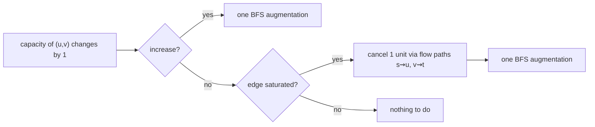

# Updating a Maximum Flow

## What it is
You have computed a maximum flow `f` in a network and then the capacity of a single edge changes by one unit. Recomputing from scratch takes `O(VE²)` (Edmonds–Karp); Problem 26-4 shows that the existing flow can be **repaired in `O(E)`** with a single graph search.

## How it works
Let `(u, v)` be the edge whose capacity changes by one unit and `|f|` the current flow value.
* **Increase `c(u,v)` by 1.** The old flow is still feasible, and the maximum flow can grow by **at most 1** (any cut containing the edge grew by 1). So: add the unit of residual capacity and look for **one** augmenting path with a search of the residual graph — if found push 1 unit, otherwise the flow was already maximum. `O(E)`.
* **Decrease `c(u,v)` by 1.** If `f(u,v) < c(u,v)` nothing breaks. If the edge was **saturated**, the flow now violates the capacity by one unit: **cancel** one unit of flow through `(u,v)` — find a flow-carrying path from `s` to `u` and from `v` to `t` (or a flow-carrying cycle through the edge) and decrease flow along it — then try **one** augmenting path in the residual graph to recover whatever value can be re-routed. The flow value drops by at most 1. `O(E)`.

## Complexity
`O(E)` per unit update (for a change of `k` units, `k` repetitions or `O(kE)`).

## When to use it
Dynamic networks (traffic, bandwidth reservations), incremental max-flow/min-cut for image segmentation as the user paints more seeds, and any situation where a flow is maintained under small changes — the same *residual repair* idea powers [capacity scaling](#/scaling_max_flow).

## In this implementation
Methods are added to `FlowNetwork`; tests apply 12 random `±1` updates to each of 100 random networks, comparing the repaired flow value with a from-scratch [Edmonds–Karp](#/ford_fulkerson) run, and checking flow conservation after every update.
