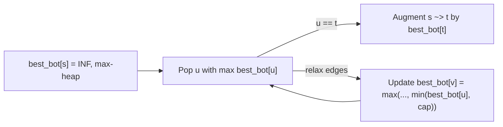

# Widest Augmenting Path Max Flow

## What it is
Unlike shortest-hop [Edmonds–Karp](#/ford_fulkerson) or greedy-capacity [Gabow scaling](#/gabow_scaling), the **widest augmenting path** strategy always chooses a residual $s$-$t$ path maximizing its **bottleneck capacity** $\min_{e \in p} c_f(e)$, bounding total augmentations to $O(E \lg |f^*|)$ regardless of residual graph topology.

## How it works
At each step on the residual graph $G_f$:
1. Run a bottleneck variant of [Dijkstra's algorithm](#/dijkstra) using a max-heap (`BinaryHeap`), maintaining `best_bot[v]` = largest bottleneck capacity from $s$ to $v$.
2. Relax edge $(u, v)$ with positive residual capacity $c_f(u, v) > 0$ via $\min(\mathrm{best\_bot}[u], c_f(u, v))$.
3. Once $t$ is popped, follow predecessor edges back to $s$ and augment by `best_bot[t]`. Because every flow decomposition breaks the remaining flow $F$ into at most $|E|$ paths, the widest path carries at least $F / |E|$ flow per step!

## Complexity
* **Per augmentation**: $O(E \lg V)$ via binary heap bottleneck Dijkstra.
* **Augmentations**: $O(E \lg |f^*|)$ (since remaining max flow shrinks by factor $\ge 1 - 1/E$ each step).
* **Total time**: $O(E^2 \lg V \lg |f^*|)$, avoiding $\Omega(|f^*|)$ tiny-bridge oscillations on unit shortcuts.

## When to use it
When capacities are large integers and sparse networks have narrow low-capacity shortcuts alongside wide trunk pipelines.

## In this implementation
`widest_augmenting_path_flow` reuses `FlowNetwork`, returns `(max_flow, augmentations, final_network)`, verifies flow conservation at all intermediate vertices, and checks exact agreement with `edmonds_karp` on 80 random capacitated networks.
