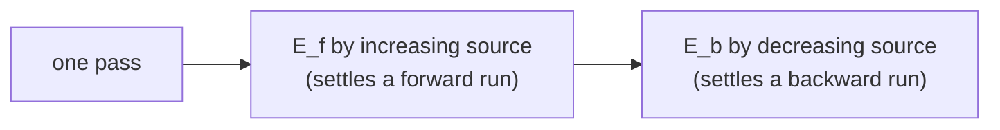

# Yen's Improvement to Bellman-Ford

## What it is
[Bellman–Ford](#/bellman_ford) relaxes every edge `|V| − 1` times because a shortest path may have `|V| − 1` edges. Problem 24-1 shows how to **roughly halve the number of passes** by choosing a clever order in which to relax edges (J. Y. Yen, 1970).

## How it works
Fix any linear order of the vertices `v₁, …, v_{|V|}`. Split the edges into
* `E_f` — **forward** edges `(vᵢ, vⱼ)` with `i < j`; the graph `(V, E_f)` is a DAG, and
* `E_b` — **backward** edges with `i > j`; likewise acyclic.

Each pass relaxes all of `E_f` in order of increasing source index, then all of `E_b` in order of decreasing source index. Along any shortest path, call a maximal stretch of forward edges a *forward run* and of backward edges a *backward run*. Within a pass, the sweep over `E_f` relaxes an entire forward run in one go (the edges appear in the order they are needed), and likewise `E_b` for a backward run. A path has at most `|V| − 1` edges and the runs alternate, so after pass `i` the first `2i` runs are settled: **`⌈|V|/2⌉` passes** (plus one to detect negative cycles) suffice. A vertex numbering that makes shortest paths zig-zag (`0 → 8 → 1 → 7 → …`) is the worst case; ordinary Bellman–Ford with edges in an unlucky order needs a pass per edge.

## Complexity
`O(VE)` as before, but with half the passes — a constant-factor speed-up of about 2.

## When to use it
Single-source shortest paths with negative edges on graphs with a natural vertex ordering (e.g. layered networks, DP lattices), and as an example of how the *order of relaxations* can matter as much as their number (compare [DAG shortest paths](#/dag_shortest_paths), which uses a topological order).

## In this implementation
Edges are sorted once per call; tests check equality with Bellman–Ford on 200 random graphs with negative weights (generated without negative cycles via potentials), the `⌈n/2⌉` pass bound, and the zig-zag worst case with `n = 21`.
