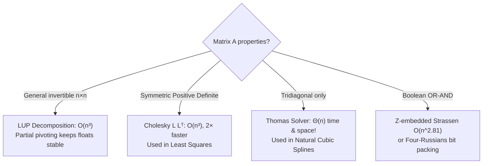

# Matrix Operations

## Introduction
Matrices show up everywhere in computer science: solving physics simulations, fitting machine-learning regression lines, rendering 3D camera transforms, finding shortest paths/triangles in graphs, and drawing smooth animation curves. CLRS Ch. 28 (`Ch. 31` in 1e–2e) strips away guesswork and focuses on **how to solve linear systems $Ax = b$ and related matrix problems accurately, stably, and fast** without getting wrecked by floating-point rounding error or singular matrices.

## What Problem Is It Solving?
- **Solving linear systems $Ax = b$ & inverting matrices:** Factor $A$ once so solving for many right-hand sides takes $O(n^2)$ instead of $O(n^3)$ ([LU & LUP Decomposition](#/lup_decomposition), [Matrix Inversion](#/matrix_inversion)).
- **Exploiting special matrix structure:** Cut $O(n^3)$ work down to $O(n)$ or faster constants when $A$ is tridiagonal or symmetric positive definite ([Cholesky Decomposition](#/cholesky), [Tridiagonal Thomas Solver](#/tridiagonal_solver)).
- **Data fitting & smooth curves:** Find the best-fit curve for noisy measurements ([Least Squares](#/least_squares)) or thread a smooth $C^2$ curve through exact control points ([Cubic Splines](#/cubic_splines)).
- **Boolean & finite-field algebra:** Fast transitive closure/triangle detection over `{0,1}` ([Boolean Matrix Multiplication](#/boolean_matrix_multiply)) and error-correcting / cryptographic linear maps ([Vandermonde & GF(2)](#/vandermonde_gf2)).

## Algorithms & Trade-Offs

| Method | Time Complexity | Stability / Condition | Key Trade-Off |
|---|---|---|---|
| **Plain LU** vs. [LUP Decomposition](#/lup_decomposition) | $\Theta(n^3)$ factor, $\Theta(n^2)$ solve | Plain LU fails if any pivot $= 0$; LUP needs only invertibility | Always prefer **LUP (with partial pivoting)** over naive Gaussian elimination without row swaps: dividing by tiny pivots magnifies floating-point errors catastrophically. |
| **Solve $Ax = b$ via LUP** vs. [Matrix Inversion](#/matrix_inversion) | Both $\Theta(n^3)$ | LUP is faster and more numerically accurate | Textbooks warn: **never compute $A^{-1} b$ to solve $Ax = b$**! Inverting $A$ does more arithmetic, accumulates more rounding error, and breaks sparsity compared to LUP forward/back substitution. |
| [Cholesky Decomposition](#/cholesky) vs. LUP | $\Theta(n^3)$ (~half the FLOPs of LU) | Requires Symmetric Positive-Definite (SPD) $A = A^T \succ 0$ | Needs zero pivoting (always stable!) and half the memory/work of LU, **but** only applies to SPD systems (such as $A^T A$ in [Least Squares](#/least_squares)). |
| [Tridiagonal Thomas Solver](#/tridiagonal_solver) vs. Dense LUP | **$\Theta(n)$** vs. $\Theta(n^3)$ | Diagonally dominant / SPD tridiagonal | Ignoring banded structure wastes $O(n^2)$ factor in time and space—crucial for PDE grids and [Cubic Spline Interpolation](#/cubic_splines). |
| **Polynomial Fit** ([Least Squares](#/least_squares)) vs. [Cubic Splines](#/cubic_splines) | $O(mk^2 + k^3)$ vs. $\Theta(n)$ | Noisy measurements vs. exact interpolation | Least squares approximates noisy data with a low-degree curve; splines pass *through* every knot smoothly ($C^2$ continuous) without high-degree polynomial wiggle (Runge's phenomenon). |
| [Boolean Matrix Multiply](#/boolean_matrix_multiply): Strassen vs. Four Russians | $O(n^{\lg 7})$ vs. $O(n^3 / \lg n)$ | Binary `{0,1}` matrices | Because `{0,1}` Boolean OR-AND lacks subtraction (`-`), Strassen fails directly over Boolean ops—you embed into $\mathbb{Z}$ first! Four Russians skips Strassen recursion overhead by packing bit rows into machine words. |

## Quick Rules of Thumb for CS Students
- **Factor once, solve many:** Computing `L, U, P` takes $O(n^3)$, after which solving $Ax = b_1, b_2, \dots$ takes only $O(n^2)$ per vector.
- **Avoid explicit inverses (`inv(A) * b`):** In numerical computing, `LUP_solve(A, b)` is both faster and noticeably more accurate than `inv(A) * b`.
- **Look for matrix shape before coding:** Tridiagonal? $\Theta(n)$ Thomas solver! Symmetric & positive definite? Cholesky! Dense general? LUP!
