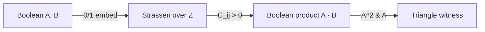

# Boolean Matrix Multiplication

## What it is
Fast multiplication of $n \times n$ boolean matrices over $(\{\text{false}, \text{true}\}, \lor, \land)$ via ring embedding into $\mathbb{Z}$ for [Strassen's algorithm](#/strassen), word-packed **Four-Russians** block lookup, and $O(n^{\lg 7})$ triangle detection.

## How it works
Because $(\{\text{false}, \text{true}\}, \lor, \land)$ is only a semiring without additive inverses, Strassen's $-1$ subtractions cannot execute directly over booleans. Section 31.3 of the 1st edition avoids this in two ways:
* **Ring embedding**: Convert booleans to $0/1$ integers, compute the integer product $C = A \cdot B$ (where $C_{ij} \in \{0,\dots,n\}$ counts shared witnesses $k$) with Strassen, and threshold $C_{ij} > 0$.
* **Four-Russians table lookup**: Group blocks of $b \approx \lfloor \lg n \rfloor$ columns/rows into $2^b$ precomputed 64-bit word OR-combinations so each row combines chunks in $O(n^3 / (w \lg n))$ bit-parallel steps.
* **Triangle detection**: An undirected graph has a triangle iff some edge $(i, j)$ also has $(A^2)_{ij} = \text{true}$.

## Complexity
* Strassen embedding: $O(n^{\lg 7}) \approx O(n^{2.81})$ arithmetic operations.
* Four-Russians packing: $O(n^3 / \lg n)$ bit-word operations (or $O(n^3 / (w \lg n))$ packed).

## When to use it
Dense transitive closures, context-free grammar CYK recognition, and triangle / short-cycle detection in dense graphs.

## In this implementation
`bool_matmul_strassen` pads to a power of two and delegates to [`strassen_pow2`](#/strassen), `bool_matmul_four_russians` builds Gray/LSB tables over 64-bit word slices, and `has_triangle` checks $A^2 \land A$.
