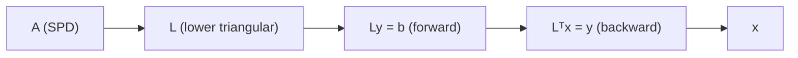

# Cholesky Decomposition (Symmetric Positive-Definite Matrices)

## What it is
A real symmetric matrix `A` is **positive definite** if `xᵀAx > 0` for every nonzero vector `x`. Section 28.5 proves such matrices have attractive properties: every leading submatrix is nonsingular, the Schur complement is again symmetric positive-definite, and consequently **Gaussian elimination needs no pivoting**. The **Cholesky decomposition** writes `A = L·Lᵀ` with `L` lower triangular and positive diagonal — it is the symmetric specialisation of the [LUP decomposition](#/lup_decomposition).

## How it works
Compute `L` one row at a time:

`L[j][j] = √( A[j][j] − Σ_{k<j} L[j][k]² )`,
`L[i][j] = ( A[i][j] − Σ_{k<j} L[i][k]·L[j][k] ) / L[j][j]` for `i > j`.

If the radicand under the square root is not positive, `A` is not positive definite — this is the cheapest known **test for definiteness**. Solving `Ax = b` then takes two triangular solves (`Ly = b`, `Lᵀx = y`). The same Schur-complement idea is the basis of [matrix inversion](#/matrix_inversion) and [least squares](#/least_squares), whose normal equations `AᵀA x = Aᵀb` involve exactly an SPD matrix.

## Complexity
`n³/3` multiply–adds — half of LU — and `n²/2` storage; numerically stable without pivoting.

## When to use it
Solving normal equations in regression, Kalman filters, Gaussian processes, sampling from a multivariate normal (`x = μ + Lz`), and checking definiteness of Hessians in optimisation.

## In this implementation
Tests reconstruct `A = LLᵀ` and verify residuals of the solves on 100 random SPD matrices (`BᵀB + I`), check the textbook example (`L = [[2,0,0],[6,1,0],[−8,5,3]]`), and make sure indefinite or singular inputs are rejected.
