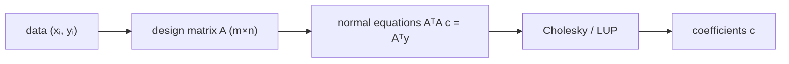

# Symmetric Positive-Definite Matrices & Least Squares

## What it is
Section 28.3 studies **symmetric positive-definite (SPD)** matrices (`A = Aᵀ` and `xᵀAx > 0` for all `x ≠ 0`) and uses them to solve the **least-squares approximation** problem: given `m` data points `(xᵢ, yᵢ)` and `n < m` basis functions, find the coefficients `c` of the combination `F(x) = Σⱼ cⱼ fⱼ(x)` minimising the sum of squared errors.

## How it works
Let `A` be the `m × n` design matrix `Aᵢⱼ = fⱼ(xᵢ)`. The error is `‖Ac − y‖²`; its gradient vanishes when

`AᵀA c = Aᵀ y`  (the **normal equations**).

Because `A` has full column rank, `AᵀA` is symmetric positive definite, so the system is solvable by [LUP](#/lup_decomposition) — or by **Cholesky** `AᵀA = L Lᵀ`, which needs no pivoting and half the work. For polynomial fitting `fⱼ(x) = xʲ⁻¹`; the book fits a quadratic to five points and obtains `F(x) = 1.2 − 0.757x + 0.214x²`.

Geometrically, `Ac` is the orthogonal projection of `y` onto the column space of `A` (the pseudo-inverse `A⁺ = (AᵀA)⁻¹Aᵀ`).

## Complexity
Forming `AᵀA`: Θ(mn²); solving: Θ(n³). For ill-conditioned problems QR factorisation is more accurate.

## When to use it
Regression, polynomial and spline fitting, calibration, signal processing (Wiener filters), and as the inner step of Gauss–Newton optimisation.

## In this implementation
`polynomial_fit` builds the Vandermonde design matrix; `cholesky` returns `None` for matrices that are not SPD. Tests recover an exact cubic and reproduce the book's quadratic coefficients.
