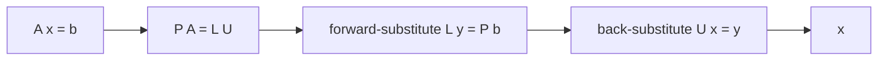

# LU and LUP Decomposition

## What it is
Solving a system of linear equations `Ax = b` is one of the most important numerical tasks. Chapter 28 (Chapter 31 in the first two editions) presents **LUP decomposition**: factor the matrix as `PA = LU`, where `L` is unit lower-triangular, `U` is upper-triangular and `P` is a permutation matrix. Then the system reduces to two *triangular* solves that cost only `Θ(n²)` each.

## How it works
1. **Gaussian elimination** zeroes the entries below each pivot. The multipliers form `L`; the reduced matrix is `U`. Each step subtracts a multiple of the pivot row — equivalently, forms the **Schur complement** of the remaining submatrix.
2. **Pivoting**: choose the entry of largest absolute value in the column as the pivot and swap rows. This avoids division by zero (plain LU fails for `[[0,1],[1,0]]`) and keeps rounding errors small. The permutation is stored compactly in an array `π`.
3. **LUP-SOLVE**: solve `Ly = Pb` by *forward substitution*, then `Ux = y` by *back substitution*.

The determinant falls out for free: `det A = (−1)^{#swaps} · Π Uᵢᵢ`.

## Complexity
Decomposition Θ(n³) (≈ 2n³/3 flops); each solve Θ(n²), so many right-hand sides share one factorisation. It is numerically stable in practice with partial pivoting.

## When to use it
Dense linear systems of moderate size, determinants, [matrix inversion](#/matrix_inversion), [least squares](#/least_squares) via the normal equations, circuit simulation (SPICE), and as the reference algorithm inside LAPACK (`dgetrf`).

## In this implementation
`lup_decomposition` follows the book's in-place algorithm; `split_lu` extracts explicit factors; tests check `PA = LU` and the residual `‖Ax − b‖` on random matrices, and Section 28.2's worked example `x = (−1.4, 2.2, 0.6)`.
