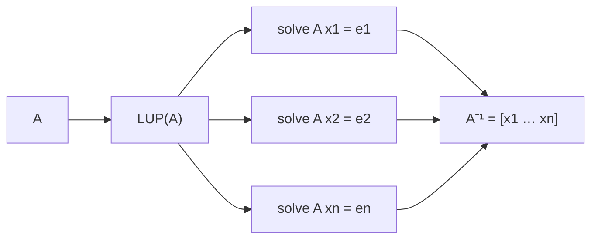

# Matrix Inversion

## What it is
The inverse `A⁻¹` of a square matrix satisfies `AA⁻¹ = I`. In practice one rarely needs the inverse itself — solving `Ax = b` directly with [LUP](#/lup_decomposition) is faster and more accurate — but Section 28.2 shows how to compute it and proves a deep equivalence.

## How it works
Write `AX = I` column by column: `A xⱼ = eⱼ` where `eⱼ` is the `j`-th unit vector. Perform **one** LUP decomposition of `A` (Θ(n³)) and then `n` forward/back substitutions (Θ(n²) each), for Θ(n³) total.

**Equivalence with multiplication** (Theorem 28.7): inversion is no harder than matrix multiplication, and vice versa. If you can multiply `n×n` matrices in `M(n)` time you can invert in `O(M(n))`, using the block formula with the Schur complement `S = D − CA⁻¹B`; conversely the inverse of the `3n × 3n` block matrix

```
| I  A  0 |⁻¹   | I  −A   AB |
| 0  I  B |   = | 0   I   −B |
| 0  0  I |     | 0   0    I |
```
contains the product `AB`, so multiplication reduces to inversion. With [Strassen](#/strassen), inversion takes `O(n^2.81)`.



## Complexity
Θ(n³) with LUP; `Θ(M(n))` asymptotically.

## When to use it
Computing covariance inverses, 3-D graphics transforms, small system identification. For large systems, prefer factorisations and solves. The condition number `‖A‖‖A⁻¹‖` indicates how errors are amplified.

## In this implementation
`invert` factors once and solves for each unit vector; tests verify `‖AA⁻¹ − I‖` and `‖A⁻¹A − I‖` on random matrices, and that a singular matrix returns `None`.
