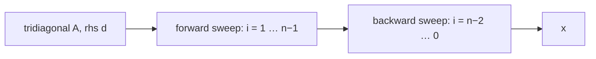

# Tridiagonal Systems (Thomas Algorithm)

## What it is
A **tridiagonal** matrix has non-zero entries only on the main diagonal and the diagonals directly above and below it. Such matrices appear whenever neighbours interact along a line: second-difference approximations of derivatives, cubic-spline interpolation, birth–death Markov chains. The exercises on LU decomposition in Chapter 28 point out that the LU factors of a tridiagonal matrix are **bidiagonal** — the band structure survives — so a system can be solved in **linear time** instead of the cubic time of general [LUP decomposition](#/lup_decomposition).

## How it works
Gaussian elimination only has to remove the single sub-diagonal entry in each column (**forward elimination**), updating the modified super-diagonal `c'ᵢ = cᵢ / (bᵢ − aᵢ c'ᵢ₋₁)` and right-hand side `d'ᵢ = (dᵢ − aᵢ d'ᵢ₋₁) / (bᵢ − aᵢ c'ᵢ₋₁)`; then **back substitution** `xᵢ = d'ᵢ − c'ᵢ xᵢ₊₁`. This is the *Thomas algorithm*. It is stable without pivoting if the matrix is diagonally dominant or symmetric positive definite (compare [Cholesky](#/cholesky)).

## Complexity
`Θ(n)` time and `Θ(n)` space (about `8n` flops), versus `Θ(n³)` for a dense solve.

## When to use it
Implicit time-stepping for the heat equation, spline construction, banded least-squares (a block variant handles banded matrices), and any chain-structured linear system.

## In this implementation
Zero pivots are reported with `None`. Tests compare with the dense LUP solver on 200 random diagonally dominant systems, verify the closed form `xᵢ = i(n+1−i)/2` for `tridiag(−1, 2, −1)` with `n = 50`, and detect a singular system. The demo solves a 200 000-unknown system instantly.
