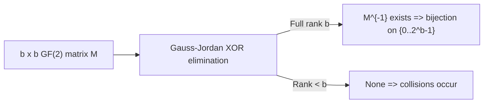

# Vandermonde Matrices & GF(2) Linear Permutations

## What it is
Two classic matrix-theoretic problems from CLRS Appendix D (complementing [LUP decomposition](#/lup_decomposition)):
1. **Vandermonde Matrix Determinant (Problem D-1)**: For evaluation points $x_0, \dots, x_{n-1}$, the matrix $V_{i,j} = x_i^j$ has exact determinant
   $$\det V(x_0, \dots, x_{n-1}) = \prod_{0 \le j < k < n} (x_k - x_j),$$
   proving polynomial interpolation is unique whenever the knots $x_i$ are distinct.
2. **Invertible $\mathrm{GF}(2)$ Linear Permutations (Problem D-2)**: Any $b \times b$ binary matrix $M \in \mathrm{GL}_b(\mathbb{F}_2)$ over arithmetic modulo $2$ maps $b$-bit integers $x \mapsto Mx \bmod 2$ as a **bijection** on $\{0, \dots, 2^b - 1\}$ — including bit-reversal permutations and [binary Gray code](#/gray_code) encoding.

## How it works
* **Exact Vandermonde determinant (`vandermonde_matrix`, `exact_det`, `vandermonde_det_formula`)**: Uses exact rational arithmetic (`Rat`) for Gaussian elimination so floating-point cancellation never corrupts $\det V$, matching the pairwise difference product identically.
* **$\mathrm{GF}(2)$ matrix group (`Gf2Matrix`)**: Represents each row as a packed `u64` bitmask (`apply(x)` computes row-parity dot products via `count_ones() % 2`). `inverse()` performs Gauss–Jordan elimination over $\mathbb{F}_2$ (`XOR` row operations), succeeding if and only if $M$ has full rank $b$ and induces a bijection on $\{0,\dots,2^b-1\}$.

## Complexity
* **Exact rational determinant**: $O(n^3)$ scalar operations.
* **$\mathrm{GF}(2)$ apply / invert**: $O(b)$ word bit operations to evaluate $Mx$, and $O(b^2)$ XOR row operations to invert $M$.

## When to use it
Vandermonde structure underpins Reed–Solomon erasure codes and Lagrange interpolation; $\mathrm{GF}(2)$ matrices model LFSRs, CRC checksums, hash mixing layers, and bit-permutation circuits.

## In this implementation
Verifies exact Vandermonde identity for random integer vectors up to size 6 and confirms that every nonsingular $\mathrm{GF}(2)$ matrix (including `bit_reversal` and `gray_encode_matrix`) yields an exact bijection whose inverse recovers every $x \in [0, 2^b)$, while every singular matrix exhibits collisions.
