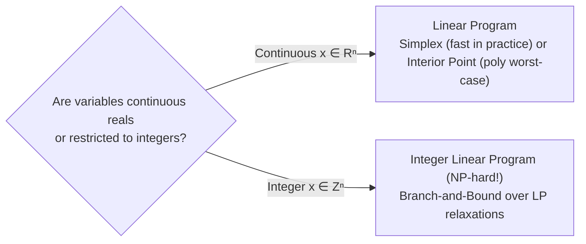

# Linear Programming

## Introduction
Imagine running a factory or scheduling delivery trucks with limited budgets, fuel, and hours, trying to maximize profit while respecting dozens of linear inequalities (`2x + 3y <= 100`, `x >= 0`). **Linear Programming (LP)** (CLRS Ch. 29, introduced in 2e) is the universal modeling language for continuous optimization. Better yet: once you know LP, you get **Duality** (an algebraic proof that your answer really is optimal!) and a crisp contrast between easy fractional LPs and NP-hard Integer LPs.

## What Problem Is It Solving?
- **Optimize a linear objective under linear inequalities:** Maximize $c^T x$ subject to $Ax \le b$ and $x \ge 0$, or determine whether any feasible $x$ exists at all ([Simplex Algorithm & Duality](#/simplex), [LP Feasibility](#/ilp_complementary_slackness)).
- **Express classic graph problems declaratively:** Formulate Shortest Paths, Max Flow, and Min-Cost Flow directly as linear programs without inventing custom algorithms ([LP Graph Formulations](#/lp_formulations)).
- **Certify optimality & handle integer variables:** Check optimality in $O(mn)$ using dual prices ([Complementary Slackness](#/ilp_complementary_slackness)) or enforce whole-number decisions via Branch-and-Bound ([Integer LP](#/ilp_complementary_slackness)).

## Algorithms & Trade-Offs

| Method | Complexity | Guarantees | Key Trade-Off |
|---|---|---|---|
| [Simplex Algorithm](#/simplex) | Exponential worst-case (Klee-Minty cubes), polynomial smoothed / fast in practice | Exact rational/float optimum + dual multipliers | Walks edges of the feasible polytope vertex-to-vertex. Incredibly fast on real-world sparse LPs, **but** poor pivot rules can cycle (Bland's rule prevents cycling) and pathological polytopes take exponential steps. |
| [LP Formulations](#/lp_formulations) vs. Dedicated Graph Algorithms | Polynomial (via LP solver) vs. $O((V+E)\lg V)$ or $O(VE^2)$ | Exact same optimal values (by total unimodularity!) | Writing Max Flow or Min-Cost Flow as an LP takes 10 lines and handles arbitrary extra side-constraints effortlessly, **but** specialized combinatorial algorithms ([Dijkstra](#/dijkstra), [Push-Relabel](#/push_relabel)) are orders of magnitude faster on pure graph instances. |
| **LP Relaxation** vs. [Branch-and-Bound ILP](#/ilp_complementary_slackness) | Polynomial vs. Exponential worst-case | LP gives upper bound; ILP gives exact integer optimum | Rounding a fractional LP solution (`x = 0.5`) doesn't always give an optimal—or even valid—integer solution (integrality gap!). Branch-and-bound uses LP relaxations to prune huge chunks of the integer search tree. |
| [Complementary Slackness](#/ilp_complementary_slackness) | $O(mn)$ verification | Necessary & sufficient optimality certificate | Given candidate primal $x$ and dual $y$, checks in linear time whether slack $\times$ dual variable $= 0$—giving an airtight proof of optimality (and the foundation of primal-dual approximation!). |

## Quick Rules of Thumb for CS Students
- **Every LP has a twin Dual LP:** By Strong Duality, if the primal maximizes profit (`<=` constraints), the dual minimizes resource shadow prices (`>=` constraints) with the **exact same optimal value**.
- **Magic property of flow matrices:** For [Shortest Paths and Max Flow](#/lp_formulations) with integer capacities, the LP vertices are *automatically integers* (total unimodularity)—no branch-and-bound needed!
- **Continuous vs. Integer is the P vs. NP boundary:** Linear Programming is in $\mathbf{P}$; adding the innocent requirement `$x_i \in \{0, 1\}$` turns it into Integer Programming, which is **NP-complete**.
