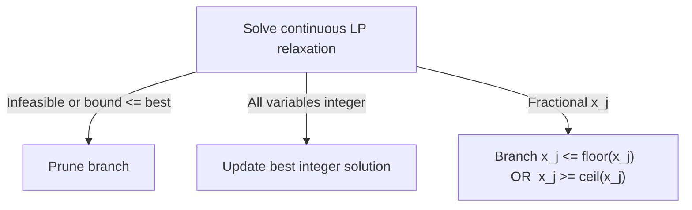

# LP Feasibility, Complementary Slackness & Integer LP

## What it is
Three foundational extensions of [the Simplex algorithm](#/simplex) from Chapter 29 problems:
1. **Linear Feasibility (`check_lp_feasibility`)**: Determine whether $\{x \ge 0 : Ax \le b\}$ is nonempty without an objective function.
2. **Complementary Slackness (`verify_complementary_slackness`)**: Certify mutual optimality of primal $x$ and dual $y$ solutions directly without solving again.
3. **Integer Linear Programming (`solve_ilp_branch_and_bound`)**: Find integral optima $x \in \mathbb{Z}_{\ge 0}^n$ via LP-relaxation branch-and-bound when fractional LP optima violate integrality constraints.

## How it works
* **Feasibility**: Solve `max 0^T x s.t. Ax <= b, x >= 0` through two-phase `simplex`, delegating Phase-I auxiliary $x_0$ minimization cleanly.
* **Complementary slackness**: Primal $x$ and dual $y$ are both optimal if and only if they are feasible ($x \ge 0, Ax \le b, y \ge 0, A^T y \ge c$) and every active variable has zero dual slack ($x_j (\sum_i a_{ij} y_i - c_j) = 0$) while every positive dual variable marks a tight primal constraint ($y_i (b_i - \sum_j a_{ij} x_j) = 0$).
* **Branch-and-bound ILP**: Solve the continuous LP relaxation; if all $x_j$ are integer, update incumbent; otherwise pick a fractional variable $x_j$ and branch into two child LPs adding $x_j \le \lfloor x_j \rfloor$ and $x_j \ge \lceil x_j \rceil$, pruning subtrees whose LP upper bound cannot beat the best integer solution found so far.

## Complexity
* **Feasibility / Slackness check**: Same complexity as a Simplex solve ($O(mn)$ per certificate check).
* **Integer LP**: NP-hard in general; branch-and-bound prunes fractional regions using continuous upper bounds.

## When to use it
Use feasibility and complementary slackness to certify optimal primal/dual pairs or debug custom solvers, and branch-and-bound when decision variables represent indivisible discrete units (items, schedules, vehicles).

## In this implementation
Reuses `simplex::simplex` and `simplex::dual` across all three routines, validating slackness certificates on 60 random bounded LPs and matching ILP optima against exhaustive integer grid search.
