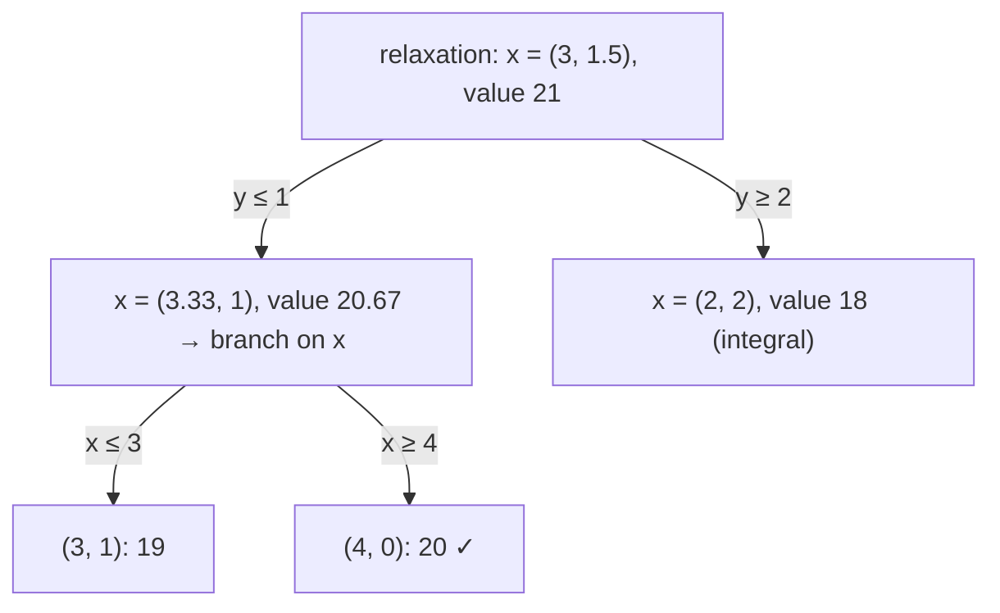

# Integer Linear Programming (Branch and Bound)

## What it is
An **integer linear program** is a linear program in which the variables must take integer values. Dropping the integrality requirement gives the **LP relaxation**, solvable in polynomial time, but its optimum is only an *upper bound* for the integer optimum. Problem 29-3 shows that ILP is **NP-hard** — for instance [0-1 knapsack](#/knapsack_01), [vertex cover](#/np_reductions) and [subset sum](#/subset_sum_np) are all one-line ILPs — and that the *feasibility* version is in NP, hence NP-complete.

## How it works
**Branch and bound.**
1. Solve the LP relaxation with the [simplex algorithm](#/simplex). If infeasible, prune.
2. If the relaxation's value cannot beat the best integer solution found so far, prune (**bound**).
3. If the relaxed solution is integral, record it as the new incumbent.
4. Otherwise pick a fractional variable `x_j = v` and **branch**: solve two subproblems, one with the extra constraint `x_j ≤ ⌊v⌋` and one with `x_j ≥ ⌈v⌉`. Every integer point lies in exactly one of them.

When the objective coefficients are integers, a subproblem can be pruned unless its relaxation exceeds the incumbent by at least 1. Real solvers add cutting planes (Gomory cuts), heuristics and presolve — *branch and cut*.

## Complexity
Exponential in the worst case (the problem is NP-hard); effective on many practical instances thanks to strong bounds.

## When to use it
Scheduling, routing, network design, cutting-stock — the workhorse of operations research (CPLEX, Gurobi, CBC). Totally unimodular constraint matrices (flows, bipartite matching) have integral LP optima and need no branching.

## In this implementation
Subproblems add rows to the constraint matrix and call this repository's `simplex`. Tests compare against enumeration of all integer points on 150 random bounded problems, and show an instance (`max 5x+4y` with LP optimum 21) whose integer optimum is only 20.
