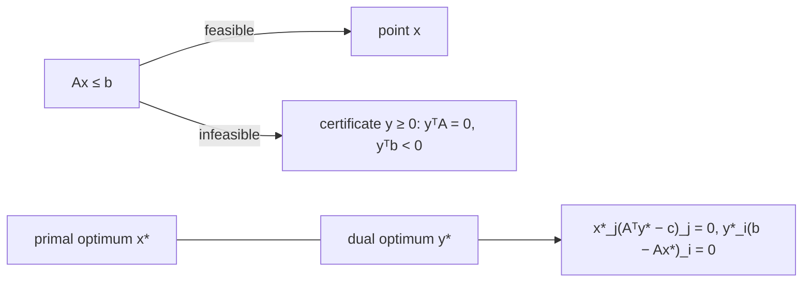

# LP Feasibility, Farkas' Lemma and Complementary Slackness

## What it is
Three problems at the end of Chapter 29 explore the theory behind the [simplex algorithm](#/simplex):
* **29-1 Linear-inequality feasibility.** Given `Ax ≤ b`, decide whether *any* `x` (possibly negative) satisfies it. This is the feasibility form of LP; it generalises [difference constraints](#/difference_constraints) (where each row has one `+1` and one `−1`), which are solved much faster by [Bellman–Ford](#/bellman_ford).
* **29-4 Farkas' lemma.** Exactly one of the following has a solution: (I) `Ax ≤ b`; (II) `y ≥ 0, yᵀA = 0, yᵀb < 0`. A vector `y` of type (II) is a **certificate of infeasibility** — non-negative multipliers whose combination of the inequalities reads `0 ≤ (negative number)`.
* **29-2 Complementary slackness.** If `x` is optimal for the primal `max cᵀx, Ax ≤ b, x ≥ 0` and `y` for the dual `min bᵀy, Aᵀy ≥ c, y ≥ 0`, then `x_j > 0 ⇒ (Aᵀy)_j = c_j` and `y_i > 0 ⇒ (Ax)_i = b_i` — a primal variable can be positive only when its dual constraint is tight, and vice versa.

## How it works
* Feasibility: split each free variable `x = x⁺ − x⁻` and run [simplex](#/simplex) with a zero objective; "infeasible" is detected by the initialisation phase.
* Certificate: solve the auxiliary LP *maximise `−bᵀy` subject to `Aᵀy = 0`, `Σy ≤ 1`, `y ≥ 0`*. Its optimum is positive exactly when the original system is infeasible, and the optimal `y` is a Farkas certificate. (The normalisation `Σy ≤ 1` keeps it bounded.)
* Complementary slackness follows from strong duality: `cᵀx = bᵀy` forces equality in every inequality of the chain `cᵀx ≤ (Aᵀy)ᵀx = yᵀ(Ax) ≤ yᵀb`.

## Complexity
One simplex run per question (exponential worst case, fast in practice; polynomial with ellipsoid/interior-point methods).

## When to use it
Proving that a system of constraints is contradictory in a checkable way (certificates are used by SMT/MILP solvers to justify infeasibility), sensitivity analysis and pricing (the dual values are shadow prices), and verifying solver output.

## In this implementation
Everything uses this repository's own `simplex`. Tests generate 300 random small systems and check that *exactly one* of a feasible point and a verified Farkas certificate (non-negative, `yᵀA = 0`, `yᵀb < 0`) is returned, with both outcomes occurring often; and check strong duality plus complementary slackness on 150 random bounded LPs.
