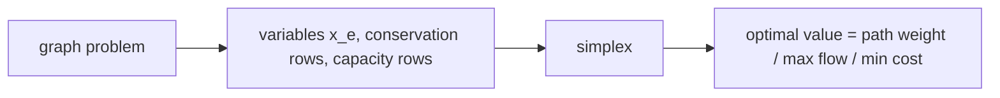

# Shortest Paths, Max Flow & Min-Cost Flow as Linear Programs

## What it is
Section 29.2 shows that many problems from earlier chapters are special cases of linear programming. Writing them as LPs gives a uniform way to solve them with the [simplex algorithm](#/simplex) — and a way to check the specialised algorithms.

## How it works
Let `x_e` be the flow on edge `e`.
* **Single-pair shortest path:** minimise `Σ w_e x_e` subject to flow conservation, with one unit leaving `s` and entering `t` (`Σ_out x − Σ_in x = +1 / −1 / 0`), `x ≥ 0`. The LP optimum is the shortest-path weight — the constraint matrix is a network matrix, so a basic optimal solution is integral (0/1 on a path).
* **Maximum flow:** maximise the net flow out of `s` subject to `0 ≤ x_e ≤ c_e` and conservation at every other vertex.
* **Minimum-cost flow:** minimise `Σ a_e x_e` subject to capacities and conservation with supply `d` at `s` and demand `d` at `t`.
* More generally: multicommodity flow, assignment, and many others (some with extra side constraints — which is where LP is genuinely more powerful than combinatorial algorithms).

Equality constraints are split into two inequalities for the standard form `Ax ≤ b` used by the simplex. The **dual** LPs have combinatorial meaning: the dual of max flow is min cut; the dual of shortest path is the potential (distance label) problem — see [difference constraints](#/difference_constraints).

## Complexity
Simplex is exponential in the worst case but fast in practice; the specialised algorithms ([Dijkstra](#/dijkstra), [Edmonds–Karp](#/ford_fulkerson), [min-cost flow](#/min_cost_flow)) are asymptotically and practically better — the LP view is for generality and verification.

## When to use it
Prototyping optimisation models with extra constraints, teaching LP duality, and verifying combinatorial solvers.

## In this implementation
Three builders use the repository's own simplex; tests compare the LP optima with [Dijkstra](#/dijkstra), [Edmonds–Karp](#/ford_fulkerson) and successive shortest paths on 60 random networks each (including infeasible min-cost instances).
