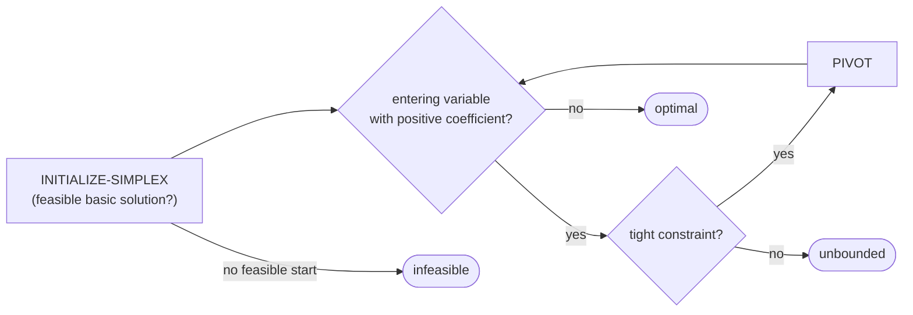

# The Simplex Algorithm & Duality

## What it is
A **linear program** optimises a linear objective subject to linear inequality constraints. The standard form used in the book is: maximise `Σ cⱼxⱼ` subject to `Ax ≤ b`, `x ≥ 0`. LP models an enormous range of problems — [shortest paths](#/difference_constraints), [maximum flow](#/ford_fulkerson), matching, resource allocation — and the **simplex algorithm** (Dantzig, 1947) is the classic method. Chapter 29 was added in the 2nd edition; the 4th edition keeps the idea but drops the detailed pivoting sections.

## How it works
* The feasible region is a convex polytope; if an optimum exists, it is attained at a **vertex**, which corresponds to a **basic feasible solution**.
* **Slack form**: introduce slack variables `x_{n+i} = bᵢ − Σ aᵢⱼxⱼ ≥ 0`. Variables on the left are *basic*, those on the right *nonbasic* (set to 0).
* **PIVOT**: pick a nonbasic variable with a positive objective coefficient (the *entering* variable), the tightest constraint limits how far it can grow (the *leaving* variable); rewrite the system exchanging their roles. Each pivot moves to an adjacent vertex with no worse objective.
* Terminate when no coefficient is positive (optimal) or no constraint limits the entering variable (**unbounded**). **Bland's rule** (always choose the smallest index) prevents cycling on degenerate vertices.
* **INITIALIZE-SIMPLEX**: if some `bᵢ < 0` the origin is infeasible; solve the auxiliary LP "minimise `x₀`" with an extra variable `x₀` to find a feasible start or prove **infeasibility**.
* **Duality**: every LP (primal) has a dual `min bᵀy, Aᵀy ≥ c, y ≥ 0`. **Strong duality** says that their optimal values are equal; the simplex tableau yields the dual solution for free.

## Complexity
Exponential in the worst case (Klee–Minty cubes) but fast in practice, typically `O(m)`–`O(m·n)` pivots; polynomial-time alternatives are the ellipsoid and interior-point methods.

## When to use it
Production planning, diet and blending problems, network flows, portfolio optimisation, and LP relaxations inside branch-and-bound and [approximation algorithms](#/lp_rounding_vertex_cover). The [Hungarian algorithm](#/hungarian) is a specialised primal–dual method for assignment LPs.

## In this implementation
A tableau-based simplex with Bland's rule and a two-phase start; `dual` builds the dual LP so strong duality can be checked numerically. Tests use the book's example (optimum 28 at `(8, 4, 0)`), infeasible/unbounded cases, vertex enumeration for 2-variable LPs and the duality gap.
