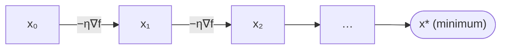

# Gradient Descent

## What it is
**Gradient descent** is the workhorse of modern machine learning: to minimise a differentiable function `f`, repeatedly step in the direction of steepest descent, `−∇f`. The 4th edition's third ML topic analyses it for convex functions and shows how the choice of step size controls convergence.

## How it works
`x_{t+1} = x_t − η·∇f(x_t)` with step size ("learning rate") `η > 0`.

For `f` convex and `L`-smooth (gradient Lipschitz with constant `L`) and `η ≤ 1/L`:
* the objective decreases at every step, and
* `f(x_T) − f(x*) ≤ ‖x₀ − x*‖² / (2ηT)` — an `O(1/T)` rate; with strong convexity the rate is **linear** (geometric).

Too small an `η` is slow; too large overshoots and **diverges** (for `f(x) = x²`, any `η > 1` blows up).

**Linear regression** is the classic application: minimise `½m‖Xθ − y‖²`, whose gradient is `Xᵀ(Xθ − y)/m` — the iterate converges to the [normal-equation solution](#/least_squares). Stochastic gradient descent replaces the full gradient with that of a random mini-batch, enabling training of neural networks on huge datasets.

## Complexity
Cost per iteration is one gradient evaluation; iterations needed `O(L‖x₀−x*‖²/ε)` for accuracy `ε` (convex), `O((L/μ) ln(1/ε))` when `μ`-strongly convex.

## When to use it
Training neural networks, logistic regression, matrix factorisation, SVMs, or any large smooth optimisation where second-order methods ([Newton](#/lup_decomposition)-type solves) are too expensive.

## In this implementation
Generic over any gradient closure; tests show convergence on a convex quadratic, the stability threshold of the step size, and agreement of gradient-descent regression with the closed-form least-squares coefficients.
