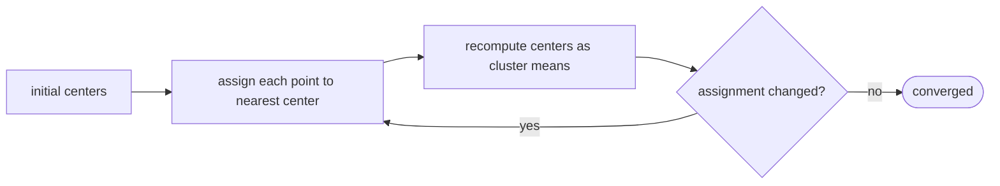

# k-Means Clustering (Lloyd's Algorithm)

## What it is
**Clustering** groups unlabeled data so that similar items land together — unsupervised learning. The 4th edition's new machine-learning chapter starts with the `k`-means problem: given `n` points in `ℝᵈ` and an integer `k`, choose `k` centers minimising the sum of squared distances from each point to its nearest center. The problem is NP-hard; **Lloyd's algorithm** is the standard heuristic.

## How it works
Alternate two steps starting from initial centers:
1. **Assignment**: attach each point to the nearest center.
2. **Update**: move each center to the **centroid** (mean) of the points assigned to it.

Both steps never increase the cost `Σ ‖p − μ_{c(p)}‖²`: the assignment step picks the closest center per point, and the mean is the unique minimiser of the sum of squared distances within a cluster (Theorem 33.1). Since the cost is bounded below and there are finitely many assignments, the algorithm **converges to a local optimum** — possibly not the global one, so run it several times or seed with *k-means++* (probabilistic choice proportional to squared distance, an `O(lg k)`-approximation in expectation).

## Complexity
`O(n·k·d)` per iteration; the number of iterations can be superpolynomial in contrived cases but is small in practice.

## When to use it
Customer segmentation, image colour quantisation, vector quantisation in codecs, initialising mixture models, and preprocessing for nearest-neighbour search.

## In this implementation
k-means++ seeding with the deterministic RNG; the cost history is returned so tests can assert monotone decrease; three well-separated blobs are recovered exactly in 10 independent runs.
