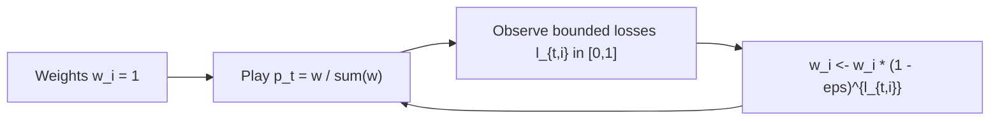

# Newton's Method, Hedge & Stochastic Gradient Descent

## What it is
Three key algorithmic extensions from the 4th edition's machine learning chapter (building on [weighted majority](#/weighted_majority) and [gradient descent](#/gradient_descent)):
1. **Newton's Method (`newton_minimize_1d`, `newton_minimize`)**: Second-order optimization using local quadratic curvature $x_{t+1} = x_t - H(x_t)^{-1} \nabla f(x_t)$ for quadratic convergence near optima.
2. **Continuous Hedge (`hedge`)**: Multiplicative-weights prediction over bounded losses $\ell_{t,i} \in [0, 1]$ generalizing binary weighted majority.
3. **Stochastic / Mini-Batch Gradient Descent (`sgd_linear_regression`)**: Shuffled mini-batch updates reducing per-step cost from $O(md)$ to $O(bd)$.

## How it works
* **Newton's method**: At each step, forms the local second-order Taylor approximation and jumps directly to its stationary point (solving $H \Delta x = -\nabla f$ via [LUP decomposition](#/lup_decomposition)). For strictly quadratic objectives, it reaches the exact global optimum in a single iteration.
* **Continuous Hedge**: Starts with uniform expert weights $w_i = 1$. In round $t$, plays mixed distribution $p_t = w / \sum w$, suffers expected loss $\langle p_t, \ell_t \rangle$, and updates $w_i \leftarrow w_i (1 - \varepsilon)^{\ell_{t,i}}$, bounding cumulative loss by $(1 + \varepsilon) \min_i L_i + \frac{\ln N}{\varepsilon}$.
* **Mini-batch SGD**: Deterministically shuffles samples with `crate::common::Rng` each epoch and steps opposite the mini-batch average gradient.

## Complexity
* **Newton step**: $O(d^3)$ per step in $d$ dimensions, with quadratic local convergence rate (far fewer iterations than first-order GD).
* **Hedge**: $O(N)$ per round, regret $O(\sqrt{T \ln N})$ with optimal $\varepsilon$.
* **Mini-batch SGD**: $O(b d)$ per update step for batch size $b$.

## When to use it
Use Newton's method when Hessians are cheap and high accuracy is required quickly, Hedge for online portfolio/expert allocation over continuous losses, and SGD when datasets are too large for full-batch gradients.

## In this implementation
Verifies quadratic convergence of 1D/ND Newton, the exact $(1+\varepsilon) L^* + \frac{\ln N}{\varepsilon}$ Hedge loss bound across 40 randomized runs, and SGD convergence matching `gradient_descent::linear_regression`.
