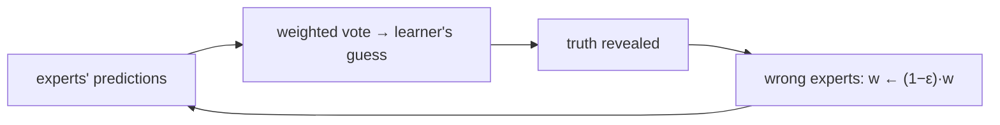

# Weighted-Majority Algorithm

## What it is
In **online learning with expert advice**, in each round `n` experts predict a binary outcome (rain tomorrow? stock up?), the learner makes its own prediction, and then the truth is revealed. The learner has no model of the world — it only wants to make **not many more mistakes than the best expert in hindsight**. The 4th edition's second ML topic is the *weighted-majority* algorithm (Littlestone & Warmuth, 1994).

## How it works
Keep a weight `wᵢ` per expert (initially 1). Each round:
1. Predict the outcome with the greater **total weight** of experts voting for it.
2. After seeing the outcome, multiply the weight of every expert that was **wrong** by `1 − ε` (`0 < ε ≤ ½`).

**Analysis (Theorem 33.?).** Let `W` be the total weight, initially `n`. Each learner mistake means experts holding at least half of `W` were wrong, so `W` shrinks by a factor `≤ 1 − ε/2`. After `m` mistakes `W ≤ n(1 − ε/2)^m`. On the other side the best expert, with `m*` mistakes, retains weight `(1−ε)^{m*}`, so `(1−ε)^{m*} ≤ n(1 − ε/2)^m`. Taking logarithms:

`m ≤ 2(1+ε)·m* + (2 ln n)/ε`.

The additive term grows only logarithmically in the number of experts — you can afford to consult thousands of them.

## Complexity
`O(n)` time per round.

## When to use it
Ensemble prediction, boosting (AdaBoost is a multiplicative-weights relative), online portfolio selection, adaptive game playing, and algorithm selection. A randomised variant (follow an expert drawn ∝ weight) improves the factor 2 to `1+ε`.

## In this implementation
The bound is asserted on 100 random experiment configurations for `ε ∈ {0.5, 0.25, 0.1}`, and a perfect expert is shown to dominate the weight vector almost immediately.
