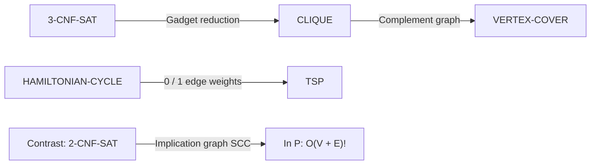

# NP-Completeness

## Introduction
Up to this point in CLRS, every problem had an efficient $O(n)$, $O(n \lg n)$, or $O(n^3)$ solution. Then you hit **Chapter 34** (`Ch. 36` in 1e)—where suddenly you meet problems like Traveling Salesman, 3-SAT, Graph Coloring, and Subset Sum for which **no known polynomial-time algorithm exists**. Understanding NP-completeness stops you from wasting weeks trying to invent a fast exact algorithm for an intractable problem, and teaches you how to *prove* hardness via **polynomial-time reductions** and spot special cases that *are* fast (like 2-SAT!).

## What Problem Is It Solving?
- **Checking answers quickly vs. finding answers (`P` vs. `NP`):** Verify a candidate certificate (tour, clique, assignment) in polynomial time ([NP Verification](#/np_verification)).
- **Proving a problem is at least as hard as everything in `NP`:** Transform known NP-complete problems into your target problem in polynomial time ([Polynomial-Time Reductions](#/np_reductions): `3-CNF-SAT ≤_p CLIQUE ≤_p VERTEX-COVER`, `HAM-CYCLE ≤_p TSP`).
- **Solving small instances or tractable special cases cleanly:** Contrast polynomial-time [2-CNF-SAT](#/two_cnf_sat) against exponential [DPLL 3-SAT](#/cnf_sat), [Held-Karp Exact TSP](#/hamiltonian_cycle), [Graph Coloring](#/graph_coloring), and pseudopolynomial [Subset Sum](#/subset_sum_np).

## Algorithms & Trade-Offs

| Problem / Solver | Complexity | Class / Boundary | Key Trade-Off |
|---|---|---|---|
| [2-CNF-SAT](#/two_cnf_sat) vs. [3-CNF-SAT (DPLL)](#/cnf_sat) | **$O(V + E)$** vs. Exponential worst-case | **In P** vs. **NP-complete** | Changing clause length from 2 literals to 3 flips the problem from linear-time SCCs on an implication graph to the canonical NP-complete problem! DPLL uses unit propagation & pure-literal pruning to beat raw $2^n$ brute force on structured formulas. |
| **Backtracking TSP** vs. **Held-Karp DP** ([Hamiltonian & TSP](#/hamiltonian_cycle)) | $O(n!)$ vs. **$O(n^2 2^n)$** | **NP-hard** | Exponentially better than $n!$: Held-Karp caches `(visited_bitmask, last_city)` so $n=20$ finishes in milliseconds instead of $20! \approx 2.4 \times 10^{18}$ steps, **but** uses $\Theta(n 2^n)$ RAM. |
| [Subset Sum Exact DP](#/subset_sum_np) vs. Exponential Search | $O(n \cdot T)$ vs. $O(2^{n/2})$ (meet-in-the-middle) / $O(2^n)$ | Weakly NP-complete (**pseudopolynomial**) | DP in target sum $T$ looks "polynomial", **but** $T$ can be $2^{100}$ when encoded in 100 bits—fast only when numbers are small! |
| **Greedy Coloring** vs. **Exact Coloring** ([Graph Coloring](#/graph_coloring)) | $O(V + E)$ vs. Exponential backtracking | $\le \Delta + 1$ colors vs. exact $\chi(G)$ | Greedy coloring in one pass uses at most `max_degree + 1` colors (and exact 2-coloring via BFS is in P!), **whereas** telling 3-colorable from non-3-colorable is NP-complete. |
| [NP Verification](#/np_verification) vs. Solving | Polynomial $O(V + E)$ vs. Exponential | Certificate check vs. Search | Even when *finding* a Hamiltonian cycle or satisfying assignment seems impossible at $n=200$, **checking** one takes milliseconds! |

## Quick Rules of Thumb for CS Students
- **Direction of a reduction matters!** To prove a *new* problem $B$ is NP-hard, reduce **FROM a known NP-complete problem $A$ TO $B$** ($A \le_p B$)—never the other way around! ("If $B$ were fast, $A$ would be fast too.")
- **Weakly vs. Strongly NP-complete:** [Subset Sum](#/subset_sum_np) runs in polynomial time *if* numbers are bounded (`<= 10^5`), whereas [Graph Coloring](#/graph_coloring) and [3-SAT](#/cnf_sat) stay hard even when every number in the input is tiny!
- **Next step when stuck with an NP-hard problem:** Either restrict input structure (trees, DAGs, 2-SAT), use Held-Karp / branch-and-bound for small $n$, or switch to [Approximation Algorithms](#/topic/approximation).
