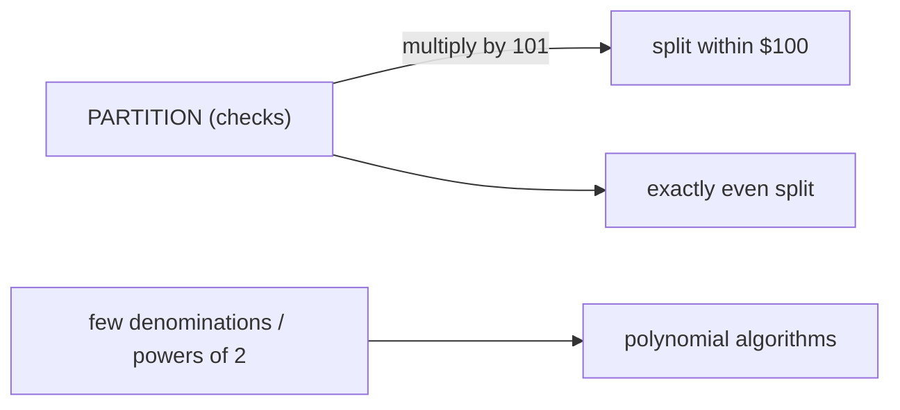

# Bonnie and Clyde (Dividing Loot)

## What it is
Bonnie and Clyde have robbed a bank and want to split the take **fairly**. Problem 34-2 asks, for four kinds of loot, whether a polynomial-time algorithm exists or the question is NP-complete. It is a compact tour of the boundary between easy and hard **PARTITION** instances (the problem is closely related to [subset sum](#/subset_sum_np)).

## How it works
* **(a) Coins of two denominations** `x` and `y` (`c_x` and `c_y` of them). Bonnie takes `a` coins of value `x` and `b` of value `y` with `a·x + b·y = total/2`. Trying every `a ∈ [0, c_x]` and solving for `b` takes `O(n)`.
* **(b) Coins that are all powers of two.** Sort in decreasing order and give each coin to whoever currently has less. If an even split exists the greedy finds it: when the coin `2^k` is placed, all earlier coins are multiples of `2^k`, so the two piles differ by a multiple of `2^k`; an exact split fails only if the difference never returns to zero. `O(n lg n)`.
* **(c) Arbitrary checks, exactly even:** this is **PARTITION**, NP-complete (reduce from SUBSET-SUM with a target `t` by adding two checks). The dynamic program over reachable sums runs in `O(n·total)` — pseudo-polynomial — which is exponential in the *bit length* of the amounts.
* **(d) Within $100 is no easier.** Multiply every amount by 101: two shares of the scaled instance differ by a multiple of 101, so a difference `≤ 100` means the difference is `0`; an exact split of the original exists iff a split within $100 of the scaled instance does. The tolerance version is therefore NP-complete too.

## Complexity
(a) `O(n)`, (b) `O(n lg n)`, (c)/(d) NP-complete; pseudo-polynomial DP `O(n·S)` for total `S`.

## When to use it
Load balancing and fair division (two machines, two heirs), and as the standard textbook example of how the *number* structure (few denominations, divisibility chains) can move a problem from NP-complete to polynomial.

## In this implementation
Tests compare (a) with enumeration of all `(a, b)`, (b) with the exact minimum difference on 500 random coin sets, and (c)/(d) with brute force over all subsets of up to 11 checks, including the scaling-by-101 reduction.
