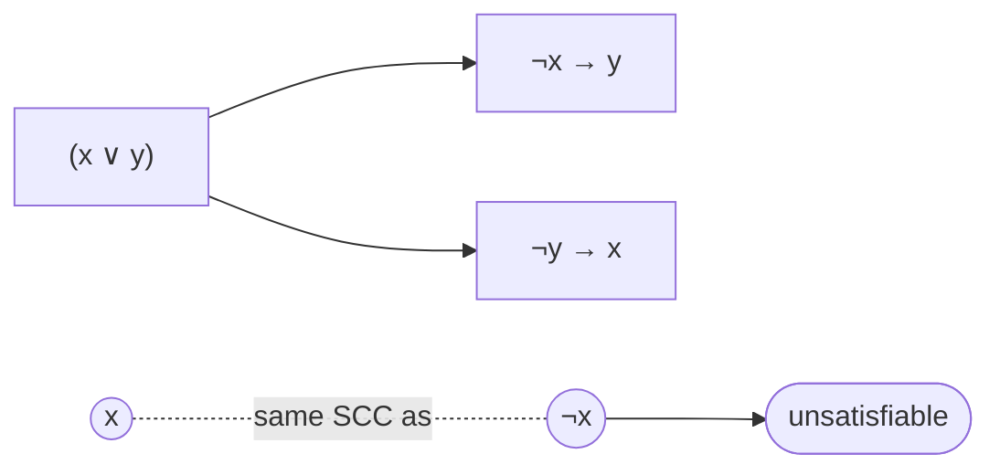

# Satisfiability: Brute Force, DPLL and 2-SAT

## What it is
**SAT** asks whether the variables of a Boolean formula can be assigned truth values making it true. In conjunctive normal form (CNF) the formula is an AND of **clauses**, each an OR of literals. SAT was the first problem proved **NP-complete** (Cook–Levin theorem); Chapter 34 shows circuit-SAT → SAT → **3-CNF-SAT**, from which many other reductions start. Yet restricting clauses to **two** literals makes it easy.

## How it works
* **Brute force**: try all `2ⁿ` assignments, verifying each in polynomial time (cf. [verification](#/np_verification)).
* **DPLL** (Davis–Putnam–Logemann–Loveland): choose a variable, branch on true/false, and after each choice *simplify*: drop satisfied clauses, shrink clauses, and apply **unit propagation** (a clause with a single literal forces its value); backtrack on an empty clause. Modern CDCL solvers (MiniSat, Kissat) add clause learning and handle millions of variables in practice.
* **2-SAT**: clause `(a ∨ b)` is equivalent to the implications `¬a → b` and `¬b → a`. Build the implication graph; the formula is satisfiable **iff no variable lies in the same strongly connected component as its negation**. A satisfying assignment follows from the topological order of the [SCC DAG](#/strongly_connected_components). Time `Θ(n + m)`.

## Complexity
Brute force `O(2ⁿ · m)`; DPLL exponential worst case but fast on structured instances; 2-SAT linear. **3-SAT is NP-complete.**

## When to use it
Hardware and software verification (bounded model checking), planning, configuration and dependency resolution (package managers), cryptanalysis, scheduling. The [reductions](#/np_reductions) show why a fast 3-SAT solver would solve [clique, vertex cover and more](#/hamiltonian_cycle).

## In this implementation
Formulas are lists of signed variable numbers (`+v` / `−v`, 1-based). Randomised tests compare DPLL and 2-SAT with exhaustive search on hundreds of small satisfiable and unsatisfiable formulas.
