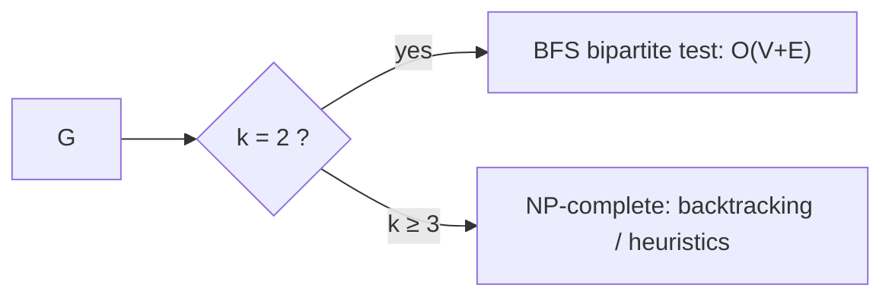

# Graph Coloring

## What it is
A **k-coloring** of an undirected graph assigns one of `k` colors to every vertex so that adjacent vertices get different colors. The **chromatic number** `χ(G)` is the smallest such `k`. Problem 34-3 studies the complexity: deciding **2-colorability is easy** (equivalent to bipartiteness), while deciding **k-colorability is NP-complete for every `k ≥ 3`**, which gives the decision form of the chromatic number problem. Colouring models any conflict-free assignment problem: exams to time slots, registers to variables, frequencies to transmitters.

## How it works
* **k = 2:** run [BFS](#/breadth_first_search), alternating colors; a conflicting edge exposes an odd cycle. `O(V + E)`.
* **Greedy:** process vertices in any order, giving each the smallest color not used by its neighbours — never more than `Δ + 1` colors (and Brooks' theorem sharpens this to `Δ` except for cliques and odd cycles). Quality depends heavily on the order.
* **Exact:** backtracking assigns colors vertex by vertex, never skipping a fresh color (symmetry breaking). Exponential in the worst case, as expected for an NP-complete problem.
* **Hardness:** 3-coloring is NP-complete by reduction from [3-CNF-SAT](#/cnf_sat) using variable "triangles" and clause gadgets (see [reductions](#/np_reductions)).

## Complexity
2-coloring `O(V + E)`; greedy `O(V + E)` (with bitmasks); exact coloring exponential — about `O(k^V)` naively.

## When to use it
Register allocation (interference graphs), timetabling, map coloring (planar graphs need ≤ 4 colors), frequency assignment. Practical solvers use DSATUR, SAT solvers or ILP.

## In this implementation
Tests compare the backtracking solver against exhaustive enumeration of all `kⁿ` colorings on 150 random graphs, the `Δ + 1` bound for the greedy rule over random orders, and the classical values for cycles, cliques and the Petersen graph (`χ = 3`).
