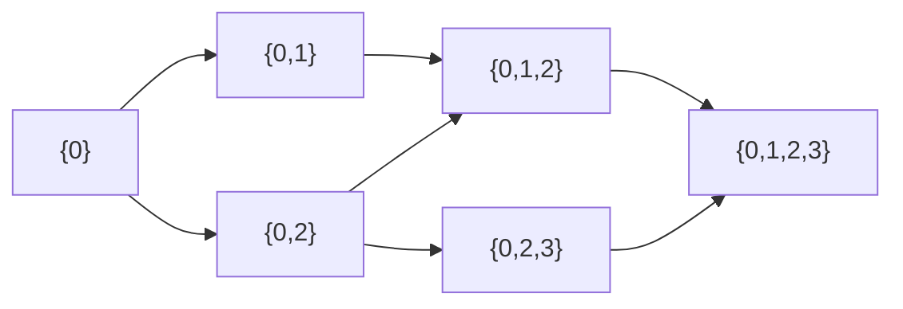

# Hamiltonian Cycle & Exact TSP

## What it is
A **Hamiltonian cycle** visits every vertex of a graph exactly once and returns to the start. Deciding whether one exists is **NP-complete** (Section 34.5.3) — in contrast to the [Euler tour](#/euler_tour) that uses every *edge* once, which is easy. Its optimisation cousin, the **travelling-salesman problem (TSP)**, asks for the cheapest Hamiltonian cycle in a weighted complete graph (also NP-complete, via [reduction](#/np_reductions)).

## How it works
No polynomial algorithm is known, so exact solvers are exponential:
* **Backtracking**: extend a path vertex by vertex, undoing choices on dead ends. Worst case `Θ(n!)`, but pruning makes it practical for sparse graphs.
* **Held–Karp dynamic programming**: let `D[S, j]` be the cheapest path starting at city 0, visiting exactly the set `S`, and ending at `j ∈ S`:
  `D[S, j] = min_{i ∈ S∖{j}} D[S∖{j}, i] + d(i, j)`. The answer is `min_j D[all, j] + d(j, 0)`. There are `n·2ⁿ` states with `O(n)` transitions each: **Θ(n² 2ⁿ)** — far better than `n!`.

## Complexity
Backtracking `O(n!)` worst case; Held–Karp `Θ(n² 2ⁿ)` time, `Θ(n 2ⁿ)` space — feasible up to ~25 cities.

## When to use it
Small instances needing exact answers: circuit-board drilling subproblems, DNA fragment assembly, route planning with few stops. For larger instances use heuristics ([Christofides](#/approx_tsp), Lin–Kernighan) or restricted tours ([bitonic TSP](#/bitonic_tsp)).

## In this implementation
`traveling_salesman_exact` accepts `f64::INFINITY` for missing edges, so the same DP decides Hamiltonicity; tests compare it with permutation search for up to 8 cities and cross-check backtracking against it on 200 random graphs (balanced yes/no).
