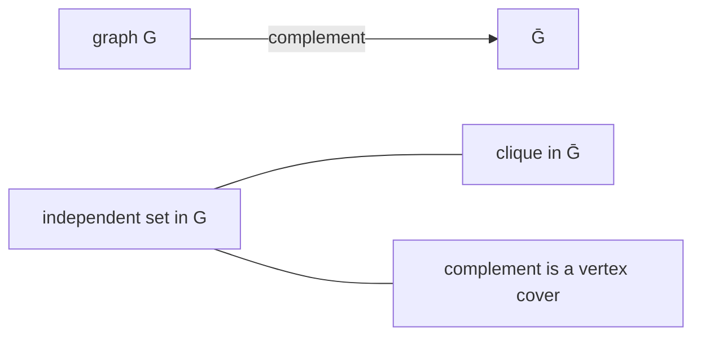

# Independent Set

## What it is
An **independent set** of a graph is a set of vertices no two of which are adjacent. Finding a *largest* one is NP-hard in general: the decision problem is NP-complete, and it is the same problem as [CLIQUE](#/np_reductions) on the **complement graph** (`S` is a clique in `G` iff `S` is independent in `Ḡ`). Problem 34-1 explores which special cases are easy.

## How it works
* **General graphs.** Exponential branching: pick a vertex `v`; either put `v` in the set (delete its neighbours) or leave it out. Always branching on a vertex of maximum degree and stopping at edge-free remainders gives `O(1.38ⁿ)`-ish behaviour in practice.
* **Trees and forests — linear time.** Root each tree. `in[v] = 1 + Σ_{c child} out[c]` and `out[v] = Σ_c max(in[c], out[c])`; the answer is `max(in, out)` at the roots. The same idea is the *company-party* DP of [Problem 15-6](#/dp_problems).
* **Bipartite graphs — polynomial.** By **König's theorem** the size of a maximum independent set is `|V| − |maximum matching|`. Compute the matching with [Hopcroft–Karp](#/hopcroft_karp) or [max-flow](#/maximum_bipartite_matching).
* **Equivalence with other problems:** independent set ↔ clique (complement) ↔ vertex cover (`V \ S`), so [approximating vertex cover](#/approx_vertex_cover) does not give a constant-factor approximation of independent set.

## Complexity
General: exponential (NP-hard, and hard to approximate within `n^(1−ε)`); trees `O(V)`; bipartite `O(E√V)`.

## When to use it
Scheduling conflict-free sets of jobs, channel assignment, selecting non-interfering sensors, and the standard hard core problem used in reductions; the tractable special cases (trees, bipartite, interval and chordal graphs) show how structure defeats NP-hardness.

## In this implementation
Graphs of up to 64 vertices use bitmask branching. Tests check exact search against enumeration on 150 random graphs, the forest DP and the König formula against the exact answer on random forests and bipartite graphs, that an odd cycle is rejected as non-bipartite, and the clique/complement equivalence on 100 random graphs.
